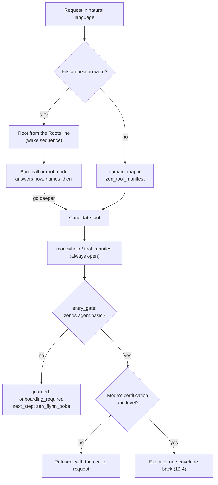

# 12. Contracts

Labels tell an agent what a node is. Contracts tell it what a tool is: what it does, what it needs, what it returns, and what it requires of the caller. Every tool carries three contracts, and each is machine-readable and checkable.

| Contract | Answers | Surface |
|---|---|---|
| Manifest | What is this tool, what does it depend on, what does it require? | `mode=tool_manifest` |
| Help | How do I call it? | `mode=help` |
| Envelope | What shape will the answer have? | Every response |

Contracts came from watching agents fail to use good tools. My success with any tool was always directly proportional to how well I described it. Once other people's agents started picking up ZenOS tools cold, every tool had to identify itself without a human explaining it. The envelope came later, from the pass that gave every tool a single exit and a common shape. And the descriptions went on a diet: every one is paid for on every turn, so a description now answers only what the tool does and when to use it, and the manual lives behind help.

## 12.1 The manifest

Every tool describes itself by calling the shared `tool_manifest()` macro in `custom_templates/zenos_ai/zenos_manifest.jinja` from its own `mode=tool_manifest` branch. A field added to the macro propagates to every compliant tool at once.

The fields that matter most:

| Field | Meaning |
|---|---|
| `tool`, `display_name`, `tier` | Identity and class (Chapter 13) |
| `version` | The tool's version. This is the canonical version of the tool (12.5). |
| `health` | Whether the tool is configured and working, with notes |
| `required_labels`, `optional_labels` | The vocabulary it depends on (Chapter 11) |
| `missing_required_labels`, `missing_optional_labels` | Computed on every call against the live label registry |
| `certs_required` | The certifications it enforces, per mode and level (Chapter 19) |
| `dependencies` | The tools it calls, each as `{tool, required, uses}` |
| `inference` | Whether it calls a model, what kind of call, and estimated tokens |
| `mcp_exposed` | Whether it is meant to be agent-reachable |
| `consumes`, `returns`, `lens_provider`, `stack` | Its Lens Bus role, when it has one |
| `modes`, `risk_class`, `limitations`, `prerequisites`, `fallback` | How it behaves and what can go wrong |

`inference` is always reported. A tool that never calls a model gets the false-shaped default automatically. `dependencies` is what ToolMap walks to build the declared dependency graph (Chapter 13). Both are declarations, not observations: the manifest says what the tool believes about itself, and the audit modes check that belief against reality.

`zen_dojotools_manifest` aggregates the manifests. `cert_audit` builds the certification catalog. `label_audit` finds missing labels. `audit` reports drift between what tools declare and what they do. `toolmap` walks `dependencies`.

## 12.2 Help

Every agent-callable `zen_dojotools_*` tool answers `mode=help` with the same shape, modeled on `zen_dojotools_locks`:

`{status: help, message: <string>}`

The message covers modes, fields, examples, and gotchas. Tools whose native selector is not named `mode` (some use `operator`, `action_type`, `action`, or `tool`) accept `mode` as an alias that takes precedence, and the legacy field still works. A caller can always send `mode=help` to any tool and get documentation back, not a side effect.

Help exists so a tool's top-level description can stay short. The description is what a model reads when choosing a tool, and it is resent on every turn, so it says what the tool is for and points at `mode=help`. The detail lives in help, fetched only when the agent needs it. This is a large share of how tool descriptions came down to a quarter to a third of their previous size in 2026.10.0.

Here is an agent reading a tool's own description instead of a manual:

<!-- screenshot: ch12_help.png -->
> **Screenshot to come.** Friday asked how to use the locks tool. She calls mode=help and answers from what the tool says about itself. Real 2026.11.0 output; personal details redacted.
<!-- /screenshot -->

`zen_dojotools_manifest mode=audit_help` checks every tool against this contract. A tool is compliant only if `mode=help` returns `{status: help, message}` and `mode=tool_manifest` returns a complete manifest. The report says which half failed. Internal-only tiers (`zen_sutra_*`, `zen_stack_*`, `zen_codex_*`) are reported as exempt, because they are never agent-callable and each is fronted by a compliant host tool. `zen_dojotools_help mode=help tool=<name>` proxies to any tool's help, and returns `status: unsupported` rather than passing a tool's live data off as documentation.

## 12.3 Semantic navigation

Manifests and help solved one problem: a tool that is found can explain itself. They did not solve finding it. By 2026.10.0 Friday could reach more than sixty tools, and every one of them sat in the same flat list. The diet in 12.2 made each entry short. It did not make the list shorter, and it did nothing about the real cost, which was choosing. Every question started with a scan of every peer, and the more capable the house became, the longer that scan got.

A library does not solve this by handing you every book at the door. It gives you a catalog, a few top-level sections you can hold in your head, and a way to go deeper from each. That is the shape 2026.11.0 gives Friday. She does not need to carry the full vocabulary of the house. She needs to know where to start looking, and every place she starts has to tell her where to look next.

### The roots

Almost every question a household asks begins with a question word, so the catalog's top level is the question words. Each one has a root: the first tool to ask.

| Root | Asks first | Then |
|---|---|---|
| who | Identity | Rolodex |
| what | Index | Inspect |
| when | Taskmaster, `mode=almanac` | Calendar, History |
| where | Room Manager | Zones |
| why | History | AlertManager, HA Log Viewer |
| how | Help | Index |
| knowledge | FileCabinet | |

A root does not answer everything in its domain. It answers what matters now and names where to go deeper. The "when" root is the clearest case: one almanac call returns a headline, the current period of the day, today's events, tasks due, meals and weather, and Calendar is where she goes when she needs a specific event.

`zen_dojotools_manifest mode=publish` builds the roots and writes them into the `zen_tool_manifest` drawer of the household cabinet. Each root has an ordered list of candidates, and the first one that exists on the install wins. An install without Taskmaster gets Calendar `mode=read` as its "when" root, and Calendar drops out of its own "then" list. A smaller install still gets a working catalog; it just points at different shelves. Publish runs at startup and after every script or automation reload, and it writes a drawer only when the content changed.

The roots reach Friday through the wake sequence. `ai_wake_sequence()` reads the drawer and renders all seven as one line, so the whole top level of the catalog costs a couple of hundred characters (Chapter 17):

```text
who=identity>rolodex | what=index>inspect | when=taskmaster mode=almanac>calendar,history | where=room_manager>zones | why=history>alertmanager,ha_log_viewer | how=help>index | knowledge=filecabinet
```

### Roots inside a tool

The core tools carry the same idea one level down. Room Manager, Index, FileCabinet, Identity and Taskmaster declare their own question-word roots in the `modes` map of their manifest. A bare call, with no mode and no input, returns those roots and a pointer to help in about 350 characters. Room Manager, called bare, answers `where` with `home_overview`, `where_room` with `get`, `route` with `pathfind`, and `emergency` with its crisis snapshot, and stops there.

Tools that declare no question-word roots answer a bare call with their modes map. Either way, a bare call is help, never an action: nothing runs without a mode. That makes every tool safe to approach cold, which is what progressive discovery needs. The full manual for a single mode is still `mode=help`, with each mode's fields under `cases.<mode>`.

### Beyond the seven

Not every request fits a question word. "Add milk to the list" is a to-do; "open a ticket for the dishwasher" is a service desk job. For those, publish also writes a `domain_map` into the same drawer: twenty named domains, from `rooms` and `food` to `finance` and `logistics`, each mapped to the script that owns it. The map is built from labels. A household registers a script for a domain by giving it the label `zen_domain_<name>`, and publish picks up whatever carries one.

The domain map is deliberately not in the prompt. The Roots line only says where it lives. It is a second shelf, read when the first one does not cover the question.

### Discovery is not permission

Finding a tool and being allowed to use it are separate questions, and the code keeps them separate on purpose. Every agent-facing tool calls `OS.entry_gate` before anything else. An agent without the `zenos.agent.basic` pass can still call any tool's `help`, `tool_manifest` and `kfc_manifest`, and a bare call counts as help. It cannot run anything else. Past the gate, each mode still checks its own certification at its own level (Chapters 19 and 20).

The open modes are exactly the discovery modes, and that is the point. An agent that cannot read how to ask for its pass can never earn one, so the catalog stays readable to everyone, and the doors stay locked to everyone without a key. The roots tell Friday where Locks lives. They do not unlock anything.



Chapter 21 makes the larger version of this argument: whoever controls the index controls what the agent believes exists. Semantic navigation is the friendly half of that sentence. It decides what Friday can find. Certification decides what she can do with it, and filtering at the source, when it lands, decides what she can see at all.

> **Not yet built.** Semantic navigation shrinks what Friday needs to know to begin. It does not yet shrink what she is sent. Every MCP-exposed tool's short description still rides on every turn, and the roots sit on top of that list rather than replacing it. Loading a tool's definition only when a root or the domain map leads to it is not built.

> **Not yet built.** No ZenOS tool assigns a `zen_domain_<name>` label to itself. `domain_map` holds only the domains an install has labeled, and on an install that has labeled none it is empty. The seven roots do not depend on it.

The principle is older than this release, even if the mechanism is new. An agent does not scale by being told everything it might ever need. It scales by knowing how to find it.

## 12.4 The envelope

A tool that has been through the single-exit pass returns every response in the canonical envelope, built by `envelope()` in `zen_os_1.jinja`:

```text
{
  status:         success | error        (did the call itself work)
  mode:           the mode that ran
  tool:           the tool's canonical name
  result:         the tool's own answer
  system_message: a priority notice for the agent, or null
  caller_token:   echoed back unchanged
}
```

`status` is the execution outcome only. Whatever the tool has to say about the world lives in `result`, in whatever shape that tool defines. A caller that reads a tool's response through `response_variable` reads domain fields from `.result`. A tool that forwards another tool's response as its own unwraps `.result` first, so its callers never see a double envelope.

`system_message` is a side channel. It reads the same priority-notice drawer the prompt uses, filtered to entries meant for tool responses, so a notice can reach an agent in the middle of a tool call instead of waiting for the next turn. It is usually `null`.

Single exit and the envelope go together. A tool computes `result` along whatever branch applies and leaves through one stop, wrapped in one envelope. It cannot leave early along a path that skipped its own checks. Every branch after a possible early answer is guarded on "no result yet", which is what stops a certification denial from being overwritten by the mode logic that would otherwise run next.

The envelope lives in `zen_os_1.jinja` on purpose. That file is already a hard dependency of the prompt and of Flynn, so importing it adds no new failure point. A missing `` target in Home Assistant's Jinja is not a soft error: it kills the whole call.

Most DojoTools, AdminTools, and plugin tools return the envelope. The ones that do not yet are listed in the `envelope()` reference in `custom_templates/zen_os1_jinja.md`. Check a tool's own reference before assuming either shape.

## 12.5 Versions

A tool's `tool_manifest` version is its canonical version. It is the number `mode=help`, `audit_help`, and ToolMap report, so it is the number every other mention must match: the header comment, the help text, the description, and the tool's readme. A file that bundles several scripts has a version per script. An automation with no manifest uses its file header.

Labels and contracts describe the graph one node and one tool at a time. The last piece of the ontology is the kinds of component ZenOS is built from, and how they find each other.

<!-- where -->
## 12.6 Where to look

Every claim in this chapter can be checked in the code. These are the places to start.

* The manifest macro every tool calls, with dependencies, inference, and exposure: [`zenos_manifest.jinja`](../../../custom_templates/zenos_ai/zenos_manifest.jinja) (`macro tool_manifest`, `dependencies`, `inference`). Docs: [zenos_manifest_jinja.md](../custom_templates/zenos_manifest_jinja.md).
* The semantic roots and the domain map, built and published: [`dojotools_manifest.yaml`](../../../packages/zenos_ai/dojotools/dojotools_manifest.yaml) (`_pub_roots`, `_pub_domain_map`). Docs: [zen_dojotools_manifest_readme.md](../scripts/zen_dojotools_manifest_readme.md).
* The Roots line in the wake sequence: [`zen_os_1.jinja`](../../../custom_templates/zenos_ai/zen_os_1.jinja) (`macro ai_wake_sequence`). Docs: [zen_os1_jinja.md](../custom_templates/zen_os1_jinja.md).
* A tool's answer to a bare call: [`zenos_manifest.jinja`](../../../custom_templates/zenos_ai/zenos_manifest.jinja) (`macro tool_roots_reply`). Docs: [zenos_manifest_jinja.md](../custom_templates/zenos_manifest_jinja.md).
* Discovery stays open, everything else needs the pass: [`zen_os_1.jinja`](../../../custom_templates/zenos_ai/zen_os_1.jinja) (`macro entry_gate`). Docs: [zen_os1_jinja.md](../custom_templates/zen_os1_jinja.md).
* The envelope: [`zen_os_1.jinja`](../../../custom_templates/zenos_ai/zen_os_1.jinja) (`macro envelope`). Docs: [zen_os1_jinja.md](../custom_templates/zen_os1_jinja.md).
* Audits: declared versus actual, help compliance, and the certification catalog: [`dojotools_manifest.yaml`](../../../packages/zenos_ai/dojotools/dojotools_manifest.yaml) (`audit_help`, `cert_audit`). Docs: [zen_dojotools_manifest_readme.md](../scripts/zen_dojotools_manifest_readme.md).
* Help-standard exemptions for Sutras, Stacks, and Codices: [`dojotools_manifest.yaml`](../../../packages/zenos_ai/dojotools/dojotools_manifest.yaml) (`startswith('zen_sutra_')`). Docs: [zen_dojotools_manifest_readme.md](../scripts/zen_dojotools_manifest_readme.md).
<!-- /where -->

<!-- nav -->
---

[← Vocabulary](11_vocabulary.md) · [Contents](00_toc.md) · [Doc hub](../readme.md) · [Components →](13_components.md)
<!-- /nav -->
