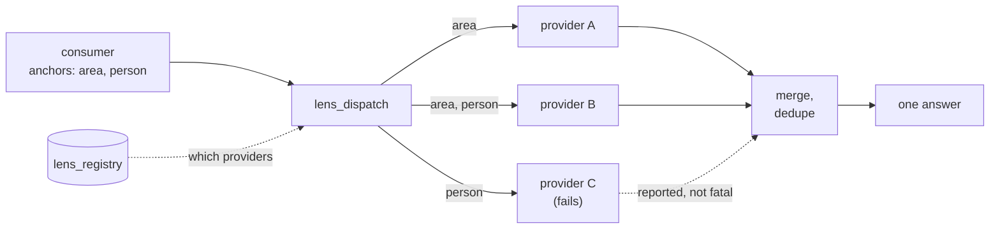

# 13. Components

The last piece of the ontology is the component vocabulary: the kinds of thing ZenOS is built from, and how they find each other at runtime. A component's class says who may call it, what it may call, and whether an agent ever sees it. Chapter 24 is the developer reference for building each class. This chapter is the reader's map.

Components started as Kung Fu: a bundle of everything about one domain, loaded into the prompt when its switch was on (Chapter 3). The point was the part a tool cannot hold. A tool can say how to talk to the meal planner. It cannot say that the household checks the meal plan first thing in the morning. Kung Fu became callable scripts when I wanted a component's view of the world on demand, and those scripts became the DojoTools. The Lens Bus is the same instinct applied to knowledge: ask the house what it knows about a room or a person without having to know who knows it.

## 13.1 Classes

| Class | Prefix | Role | Agent-exposed |
|---|---|---|---|
| DojoTool | `zen_dojotools_*` | A capability offered to agents: semantic modes, label-resolved targets, envelope responses | Yes, when intended as a capability |
| SystemTool | `zen_dojotools_systemtools` and kernel services | Platform health, logs, reloads, configuration surfaces | Safe modes only |
| AdminTool | `zen_admintools_*` | The configuration and recovery plane: certifications, cabinet repair, resets, loaders | No |
| Root | `zen_root_*` | Raw transport to an external system (an API, an auth provider) | Never |
| Sutra | `zen_sutra_*` | An internal adapter that does the work behind a DojoTool | Never |
| Stack | `zen_stack_*` | A Lens Bus provider that answers anchor queries with evidence | No, routed through Lens dispatch |
| Codex | `zen_codex_*` | Domain policy and rules a DojoTool delegates to | No, routed through its host |
| Kung Fu Component | KFC drawer | A summarized domain view the Monastery keeps fresh (Chapter 14) | Mounted as context, not called |
| Boot orchestrator | Flynn | Staged startup and health gating | Never |

A name is a strong hint, not a guarantee. A `zen_dojotools_*` script can be internal-only when it exists as a provider implementation, and its manifest says so through `mcp_exposed`. Exposure is a declared policy, not an inference from the name.

The common composition for a consequential capability is layered: an agent calls a DojoTool mode, the DojoTool resolves targets and delegates policy to a Codex, the Codex checks identity and certification through the chokepoint (Chapter 18), asks for a live acknowledgement if its policy requires one (Chapter 20), and only then calls the Root that talks to the outside system. Configuration of that capability lives in an AdminTool the agent cannot reach.

## 13.2 Kung Fu Components and self-registration

A Kung Fu Component (KFC) is a domain the Monastery summarizes: security, alerts, tasks, the physical plant, and so on. Its definition lives in a drawer in the Dojo cabinet: what labels it reads, what triggers it subscribes to, its pipeline tier, its staleness ceiling, and its instructions (Chapter 14).

Under KF6, a tool owns its own KFC. The tool carries the `zen_kfc_provider` label and answers `mode=kfc_manifest` with its component definition. `zen_dojotools_manifest mode=bootstrap_kfc` runs on Home Assistant start and daily, finds every tool labeled `zen_kfc_provider`, collects each `kfc_manifest`, and mounts the result into the Dojo cabinet. Nobody authors a KFC drawer by hand. Adding a tool that owns a domain adds that domain to the Monastery.

## 13.3 The Lens Bus

The Lens Bus is how a tool asks "what does the house know about this?" without knowing who knows it. The question is an anchor: a label, a person, an area, or a zone. The answers are evidence from whichever providers consume that anchor type.

It is also how the house comes to know things Home Assistant has never heard of. Almost any source can join, if it meets three conditions:

1. **It can be queried.** An API, a search endpoint, a REST or GraphQL call, a database behind a service, or Home Assistant's own state.
2. **Its records can be attached to the taxonomy.** Something in the source has to line up with an anchor: a tag that matches a label, a field that names an area or a person. That one attachment is the whole integration. The source does not need to understand ZenOS. It needs one field that means what a label means.
3. **It can answer in JSON.** Bounded evidence, each item with a stable ID and where it came from, not a dump of everything the source holds.

Wiki.js is the clearest example. A page tagged `garage` is evidence about the `garage` label. When a consumer asks about that anchor, the Wiki.js provider runs one GraphQL query for pages carrying that tag and returns each one as an evidence item: an ID, a title, a path, and the anchor it matched. Wiki.js knows nothing about Home Assistant. The tag is the bridge. The same pattern brings in finance transactions, documents, service-desk tickets tagged with an area or label, CRM records, the household's own catalog, media, timers, and alarms; the reference household has 17 providers registered (Appendix F).

This is the hypergraph again (Chapter 7). A label already joins entities, areas, and cabinets. The Lens Bus lets it join records in systems that live outside the house. And because a consumer never names a provider, adding a provider adds knowledge to every consumer at once. Inspect, Index, and Room Manager pick it up without a line of their code changing.

The Library is the hub, and I rebuilt it to be one. It works the way a library does. Every source is a collection. The labels are the subject headings, the Dewey Decimal System of the house, so a question about one subject finds every card filed under it, whatever collection the card points into. And like a real library, it keeps a catalog of its own, run the way a librarian would run one.

That catalog is where the Library and Inventory meet, and they split the work the way library science does (the FRBR model). Inventory, the household's Grocy-backed stock system, holds the work: what a thing is. The Library adds an item record for each physical copy: where it is shelved, who has it, when it is due back, and the details a cataloguer would keep, ISBN and series and publisher among them. Barcode in, shelved automatically, deduplicated on ISBN, loaned and returned. Books, games, recordings, videos, periodicals, and art prints ship as types. A new kind of item, heirlooms or a tool collection, is one entry in the Library's type registry and one label; no new logic. Every item type carries a label, so the catalog is part of the taxonomy like everything else.

Put them together and a book stops being a row in a list. Its shelf is an Inventory location, the location is in a room, and the room is an area, so "what books are in the living room?" is an ordinary Lens query on the living room. A copy that also exists digitally points at it, and the evidence carries a playback hint in the same shape Media Manager uses, so the record album on the shelf and the album in the stream are one answer. A cookbook can point at its Mealie cookbook. Nothing about the book changed. It just joined the graph.

Providers own their data. The Library owns the rules for joining, because a knowledge source should be admitted once, under one contract, not wired by hand into every tool that might want it.

The rules are strict on purpose. Providers consume typed anchors, return bounded evidence that is redacted by default, and declare their own health and failure policy. A lookup is a read. Creating or changing a record in a source is that tool's own mode, behind its own certifications, and never part of the bus.

Providers are Stacks (and some DojoTools acting as providers). Each declares in its manifest what anchor types it consumes and what evidence types it returns, and registers itself into the household cabinet's `lens_registry` drawer with `mode=register`. `zen_dojotools_manifest mode=bootstrap_stacks` runs on start and daily and registers any provider that declares a registration mode and is not already registered.

`zen_dojotools_lens_dispatch` is the one consumer entry point. It groups the anchors by type, calls only the providers whose declarations match, applies soft-failure semantics (a failed provider is reported, not fatal), deduplicates evidence, and returns one merged answer. It unwraps each provider's `.result` before merging, so enveloped and not-yet-enveloped providers merge identically. Consumers such as Inspect, Index, and Room Manager ask the Library or the dispatcher, never a provider directly.

## 13.4 ToolScan and ToolMap

System-wide questions about tools (which tools exist, what they require, what they depend on) are answered by fanning out across every tool's manifest.

`zen_admintools_toolscan` is the shared collector. It exists as its own script because Home Assistant refuses to let a script call itself, so a manifest mode that needs to call every tool, including the manifest tool, cannot do it from inside that tool. `zen_dojotools_manifest` modes `toolmap`, `domains`, `label_audit`, `cert_audit`, and `audit` all collect through ToolScan.

`zen_dojotools_manifest mode=toolmap` walks the `dependencies` each tool declares and builds the dependency graph: what depends on Identity, what breaks if FileCabinet is unhealthy, whether a missing dependency is actually missing or just undeclared. It is a declared graph, not runtime tracing. The tools say what they need, and ToolMap checks that it is there.

That is the ontology: labels for what things are, contracts for what tools do, and classes for what components may reach. With a graph and a way to read it, Part IV turns to what the agent builds when it reads: the twin, starting with how it is kept current before anyone asks.

<!-- where -->
## 13.5 Where to look

Every claim in this chapter can be checked in the code. These are the places to start.

* KFC self-registration and Lens provider registration on start and daily: [`dojotools_manifest.yaml`](../../../packages/zenos_ai/dojotools/dojotools_manifest.yaml) (`bootstrap_kfc`, `bootstrap_stacks`, `zen_kfc_provider`). Docs: [zen_dojotools_manifest_readme.md](../scripts/zen_dojotools_manifest_readme.md).
* The single Lens Bus consumer entry point: [`dojotools_dispatcher.yaml`](../../../packages/zenos_ai/dojotools/dojotools_dispatcher.yaml) (`zen_dojotools_lens_dispatch`). Docs: [zen_dojotools_dispatcher_readme.md](../scripts/zen_dojotools_dispatcher_readme.md).
* Library, the Lens owner for knowledge: [`dojotools_library.yaml`](../../../packages/zenos_ai/dojotools/dojotools_library.yaml) (`zen_dojotools_library`). Docs: [zen_dojotools_library_readme.md](../scripts/zen_dojotools_library_readme.md).
* Stack providers: [`zen_stack_presence.yaml`](../../../packages/zenos_ai/dojotools/zen_stack_presence.yaml) (`zen_stack_presence`). Docs: [lens_bus.md](../library/lens_bus.md).
* ToolScan, the fan-out behind ToolMap and the audits: [`dojotools_toolscan.yaml`](../../../packages/zenos_ai/dojotools/dojotools_toolscan.yaml) (`toolscan`).
<!-- /where -->

<!-- nav -->
---

[← Contracts](12_contracts.md) · [Contents](00_toc.md) · [Doc hub](../readme.md) · [The Monastery →](14_the_monastery.md)
<!-- /nav -->
