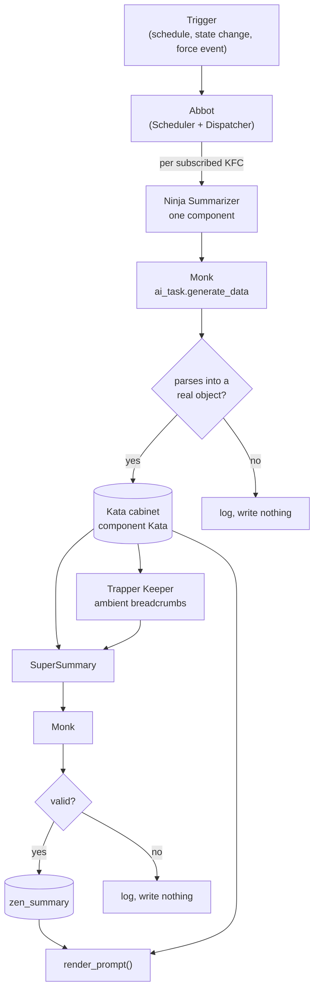

# 14. The Monastery

The twin is not built on every conversation turn. It is kept current in the background by the Monastery: a pipeline that reads each domain of the house through its labels, asks a model to summarize it into a fixed shape, validates the answer, and stores it. When Friday needs to know the state of the house, the summary is already there.

The Monastery exists because of a bill. Early on, the whole interactive prompt was summarized every hour by a cloud model, and it came to well over a hundred dollars a month for summaries alone. Summarizing one domain is a small job that a small local model can do, so the work moved to local workers, one component each, fired by triggers because they cost almost nothing to run. The summaries got cheaper and fresher at the same time, and the interactive prompt got smaller and faster because it carried less. It could also reach more: anything summarized away was still a tool call from the agent, so less in the prompt meant more within reach. The lore followed: the workers were monks, their results were Katas posted to an archive, and the local model directing them was Kronk, curator of the Monastery.

It is also where retrieval lives. I am not against retrieval. I think it belongs downstream, not at the front of an agent that runs a house. History and memory are gathered and reduced here, before the agent sees anything, so retrieval becomes part of the system's intelligence instead of the agent's burden.

> **Not yet built.** Search and vector backends that plug in behind the index are under investigation. The exact mechanism is deliberately left open, to be whatever serves each tool best. What is not open is how it looks to the agent: search and retrieval are one seamless capability, always, however many backends sit behind them. Seamless does not mean indistinguishable, and three constraints come with it. Every result says what kind of evidence it is: an exact label match, live state, a Kata, or a semantic match with its score, so a fuzzy match never reads like a fact. Empty stays a valid answer: semantic search always has a nearest neighbor, so a relevance floor keeps "found nothing" possible and the default out intact (Chapter 2). And nothing is returned that the caller could not have reached anyway: results are filtered by what the caller may traverse before they are ranked, so search never becomes a side door around certification and scope (Part V).

## Before the machinery: one leak

Part IV has a lot of names in it. Here is one ordinary event walking through all of them.

A leak sensor under the kitchen sink reads wet. Your leak shutoff, an ordinary Home Assistant automation, has already closed the valve; it did not need an LLM to decide whether water is wet (Chapter 1). Everything below is about what Friday knows, not what the valve does.

The sensor carries the `alert_manager` label and `alert_when_on`, which says wet is the bad direction. Alert Manager is a Kung Fu Component (Chapter 13): it reads every entity with its label. The Abbot (Chapter 22) decides when it runs. Alert Manager subscribes to the `zen_leak` trigger, so a sensor that also carries the `zen_leak` label wakes it at once; anything else waits for its next scheduled sweep. Smoke, carbon monoxide and gas (`zen_smoke`) and a triggered alarm panel (`alarm_panel`) wake it the same way.

When it runs, a Ninja reads the labeled entities and a Monk, the model call, summarizes them into a fixed shape: which entity deviates, how urgent it is, and whether anything should be done. If the answer does not parse, nothing is written. If it does, it is stored as a Kata, and SuperSummary folds it into the whole-house view (14.3). If the component says action is required, it can act only through the act Postman declares, behind Postman's emit cert (14.4). A leak is life-safety urgency, which skips the cert layer and the cooldown, but not the master switches.

Then you ask Friday what is going on in the kitchen. The answer is already in her frame (Chapter 17): the Kata says the sink sensor is wet. If you ask for more, she reads the sensor itself and its history through the graph (Chapter 7). She never had to discover the leak. The Monastery had already written it down.

## 14.1 The pipeline

The pieces:

| Piece | What it is |
|---|---|
| Kung Fu Component (KFC) | A domain definition in the Dojo cabinet: what it reads, what triggers it, its tier, its instructions (Chapter 13) |
| Ninja Summarizer | `zen_dojotools_ninja_summarizer`. Produces one component's Kata. |
| Monk | The inference step inside every summarizer: one `ai_task.generate_data` call against the entity `input_text.zenos_ai_task_entity` names |
| Trapper Keeper | An ambient-tier pre-digest that compresses low-urgency components into one-line breadcrumbs |
| SuperSummary | `zen_dojotools_supersummary`. Consolidates everything into `zen_summary`. |
| Abbot | The Scheduler and Dispatcher, deciding when each of the above runs (Chapter 22) |

A Monk is not a separate agent or layer. It is the model call, made once per component and once for the whole-house summary.

## 14.2 Ninja: one component

For one KFC, the Ninja Summarizer:

1. Reads the component definition from the Dojo cabinet. A component whose `role` is `cache` is skipped: it is a slot a trigger pack writes (Security Manager's perimeter, panel and camera slots), not a summary, so a run can never overwrite it.
2. Checks that the agent the run acts as may read what it is about to read (14.6).
3. Gathers context. A component with a `seed` or `area_seed` calls a tool (for example Room Manager `mode=get` for an area) to get its context. Otherwise it runs an Index call over the component's declared labels. The seed must be a mode the tool declares for the summarizer (`seed_modes` in its `tool_manifest`); any other seed stops the run before the model is called.
4. Loads the component Kata schema, `kata_template`, and the component's previous Kata for continuity.
5. Builds a prompt: instructions, the schema to fill, an example, the gathered context, trigger notes, and the act the component's tool declares, if any.
6. Calls the Monk.
7. Validates the result and writes it to the Kata cabinet under the component's `kata_key` (Chapter 15).
8. Decides whether anything needs to escalate (14.4).

## 14.3 SuperSummary: the whole house

SuperSummary reads every active component's Kata and produces one whole-house summary, `zen_summary`. A component is active if its definition has a `kata_key`, its `meta.enabled` is true or absent, its minimum level (`meta.requires`, if it sets one) is met by the agent the pipeline acts as, and its Kata exists. A component that is off or unmet stays out of the agent's prompt as well, and its Kata is kept.

Components are handled by tier:

| Tier | How SuperSummary sees it |
|---|---|
| `keeper` (the default) | Full Kata included |
| `ambient` | Pre-digested by Trapper Keeper into a breadcrumb. Urgency 4 or 5 adds it to the attention list. Urgency 6 or higher promotes it to full inclusion. |
| `system` | Never included as component data. Today the only system-tier component is Trapper Keeper itself, whose output reaches SuperSummary as the ambient index |

Trapper Keeper exists to keep SuperSummary's prompt small. Most components are quiet most of the time, and a quiet component does not need its full Kata in the whole-house prompt. Trapper Keeper hands SuperSummary an index of breadcrumbs with pointers back to the full Katas, and SuperSummary only pulls in what is urgent.

SuperSummary is bounded three ways: a run governor (`super_burnout_seconds`, default 600, so it runs at most once per window unless forced), a context budget (`max_context_tokens`, default 28,000, which drops ambient and system components before keeper ones), and a hard size guard (a prompt over 200,000 bytes aborts).

Here is what that synthesis reads like when Friday is asked for it:

<!-- screenshot: ch14_briefing.png -->
> **Screenshot to come.** Friday asked for a briefing. The answer is SuperSummary's whole-house view, with what matters first and how urgent it is. Real 2026.11.0 output; personal details redacted.
<!-- /screenshot -->

## 14.4 Escalation

A component Kata can say that something needs action: `action_required`, an `urgency` from 0 to 10, and optionally a `suggested_act_event` naming a tool call that would address it, with `suggested_act_args`. The Ninja Summarizer routes that three ways.

**Refresh the whole house.** If urgency is at or above the component's `drift_threshold`, it fires `summary_force`, so `zen_summary` reflects the change now rather than at the next scheduled run.

**Act autonomously**, through a gated path. A suggested action is emitted only if all of these hold: the component asserted `action_required`, urgency is at or above the push floor (default 4) or the life-safety threshold, and then three layers pass in order:

1. **Infrastructure deny.** A suggested action that targets the dispatcher or tool router is refused outright and logged as critical. A summary cannot escalate into the routing layer.
2. **Emission switch.** `input_boolean.zen_action_emission_enabled` must be on. It is off on a fresh install, and it is operator-only: no agent can write it.
3. **The emit cert.** The target tool names the cert a background act needs: the one in its `certs_required` whose `st_ok` allows the Ninja emit stage `e`. The agent the run acts as must hold that cert with stage `e`, which a person approved on a phone (Chapter 19). The act must also be one the tool declares (`act: {mode, args, description}` in its `tool_manifest`), with arguments that fit the declaration; otherwise it is refused as `no_act_declared` or `act_args_invalid`. A life-safety urgency skips this layer, as Postman's own gate does; the first two still apply.

A refused act is written onto the component's Kata as `act_blocked`, naming what to grant, so the refusal is visible where the decision was made.

**Summaries can start other summaries.** The Ninja declares its own act, `run`, behind `zenos.pipeline.chain`. A component may start only the components it lists in `chain_to`, each hop passes every gate on its own, a component already on the chain is refused (`chain_loop`), and a chain stops three deep (`chain_depth`).

> **Not yet built.** Through 2026.11.0 the old act whitelist is a bridge: an act whose cert the agent holds for interactive use only still goes through when its tool is on the list, stamped legacy, with a notice saying which stage to grant. The bridge and the list go in 2026.12.

**Ask a human.** Anything that needs attention but has no automatable action goes to `zen_dojotools_urgency_handler`, which opens or updates a task (Chapter 22). Before escalating, the summarizer checks `zen_dojotools_alertmanager mode=check_ack` for the component. If a household member has acknowledged the condition, the escalation is suppressed until the acknowledgement expires or is revoked (Chapter 15).

A cooldown per component (`emission_cooldown_minutes`) stops the same condition from escalating repeatedly. Life safety is the exception: at or above the life-safety bypass (`push_gate_life_safety_bypass`, default 8), the cooldown never holds an emission back, so a leak is not kept waiting because a low-battery alert went out ten minutes earlier.

## 14.5 Kill switches

Three switches stop the pipeline, checked master first:

| Switch | Default |
|---|---|
| `input_boolean.zen_summarizers_enabled` (master) | Off on a fresh install |
| `input_boolean.zen_ninja_summarizer_enabled` | On |
| `input_boolean.zen_supersummarizer_enabled` | On |

The master ships off so a new install does not start continuous background inference before its owner has pointed `input_text.zenos_ai_task_entity` at something appropriate. The Ninja Summarizer runs several times an hour, and SuperSummary at least four times an hour, which is why the recommended target is a local model. Turning a switch off changes nothing else. Turning one back on fires the corresponding force event within seconds.

## 14.6 What a run may read

A run acts as the agent responsible for the household (Chapter 20), and that agent's certifications decide what the run may read, before the model sees anything.

**The agent must be onboarded.** If it isn't, the run refuses with `agent_not_onboarded`, summaries pause, and a notification says why.

**A component can require a level.** A component's `meta.requires` names a certification and level. The agent must hold it at that level or higher, granted for the Ninja seed stage `s`, or the run stops with `kfc_cert_required` and the last Kata stays. A component the agent doesn't meet also stays out of the agent's prompt. No shipped component sets a requirement.

**Private data needs a read cert.** A tool can tag a seed mode with the certification that reads it (`mode@cert:level`): Finance's summaries carry `zenos.finance.read`, Room Manager's `home_overview` carries `zenos.presence.read`, and Taskmaster's medications carry `zenos.health.read`. The agent must hold that certification for stage `s`. Its Kata is stamped with what it needed, and every prompt feed drops a Kata whose stamp the agent no longer meets, so revoking the cert takes the data out of the prompt too.

One switch, `seed_cert_mode` in the system cabinet, decides what a missing read cert does. In audit, the run goes ahead and logs `seed_cert_audit`; in enforce, it stops with `seed_cert_required` before the seed tool is called. A fresh install starts in enforce and asks for `zenos_agent_parity` when onboarding completes; an upgraded install stays in audit until its owner switches it from the console. `zenos_agent_parity` is one bundle built from what the enabled summaries actually need, so one approval on a phone keeps them all running.

> **Not yet built.** Through 2026.11.0 the old seed whitelist is a bridge: a tool that declares no `seed_modes` still seeds when it is on the list, stamped legacy. The bridge and the list go in 2026.12.

The Monastery decides when and how each domain is summarized. The next chapter is the shape every one of those summaries takes.

<!-- where -->
## 14.7 Where to look

Every claim in this chapter can be checked in the code. These are the places to start.

* The per-component summarizer and the whole-house synthesis: [`dojotools_summarizers.yaml`](../../../packages/zenos_ai/dojotools/dojotools_summarizers.yaml) (`zen_dojotools_ninja_summarizer`, `zen_dojotools_supersummary`). Docs: [zen_dojotools_summarizers_readme.md](../scripts/zen_dojotools_summarizers_readme.md).
* SuperSummary's run governor and context budget: [`dojotools_summarizers.yaml`](../../../packages/zenos_ai/dojotools/dojotools_summarizers.yaml) (`super_burnout_seconds`, `max_context_tokens`). Docs: [zen_dojotools_summarizers_readme.md](../scripts/zen_dojotools_summarizers_readme.md).
* The operator gate on action emission: [`dojotools_summarizers.yaml`](../../../packages/zenos_ai/dojotools/dojotools_summarizers.yaml) (`zen_action_emission_enabled`). Docs: [zen_dojotools_summarizers_readme.md](../scripts/zen_dojotools_summarizers_readme.md).
* Seeds, read certs, acts and chains: [`dojotools_summarizers.yaml`](../../../packages/zenos_ai/dojotools/dojotools_summarizers.yaml) (`seed_cert_required`, `act_blocked`, `chain_to`); the stage checks and the read-cert switch: [`zen_identity.jinja`](../../../custom_templates/zenos_ai/zen_identity.jinja) (`macro caller`, `macro seed_cert_mode`, `macro kata_seed_ok`). Docs: [zen_dojotools_summarizers_readme.md](../scripts/zen_dojotools_summarizers_readme.md).
* The catch-all for attention that has no automatable action: [`dojotools_dispatcher.yaml`](../../../packages/zenos_ai/dojotools/dojotools_dispatcher.yaml) (`zen_dojotools_urgency_handler`). Docs: [zen_dojotools_dispatcher_readme.md](../scripts/zen_dojotools_dispatcher_readme.md).
<!-- /where -->

<!-- nav -->
---

[← Components](13_components.md) · [Contents](00_toc.md) · [Doc hub](../readme.md) · [Katas →](15_katas.md)
<!-- /nav -->
