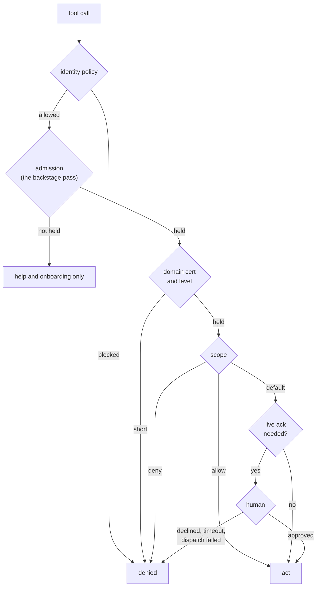
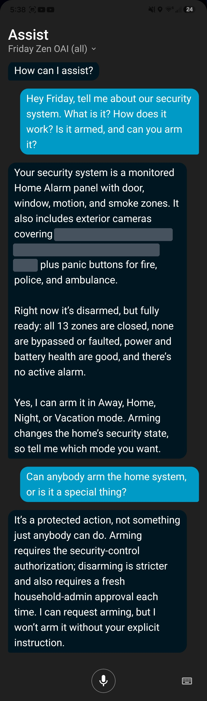

# 20. The Authority Ladder

Chapter 19 describes what a certification is. This chapter describes how authority is layered: what an agent must have before it can act, who can change what an agent has, and where a human stays in the loop no matter what the agent holds.

The clearest way I have found to explain the ladder is one ordinary sentence: put the living room back on Auto. If the room is paused, that sentence asks to take back authority a human deliberately removed, and neither the tool nor the model decides whether Friday is trustworthy enough to do it. The tool asks Identity. Putting a room into pause needs no permission at all, because it hands authority back to a human. That asymmetry runs through the whole ladder: actions that increase safety are open, and actions that reclaim authority are gated.

Here is that sentence on a real install, and the push it produces:

<!-- screenshot: ch20_unpause_live_ack.png -->
> **Screenshot to come.** Friday asked to put a paused room back on Auto, and the live acknowledgement it sends to a household admin's phone. Real 2026.10.0 output; personal details redacted.
<!-- /screenshot -->

## 20.1 The rungs

Each rung is necessary, and none substitutes for another.

The administrative plane sits beside this path, not on it: it changes the policy the path reads.

| Rung | What it decides | Where it is enforced | Status |
|---|---|---|---|
| Identity policy | Is this caller's identity acceptable at all? | `resolve_caller_identity`, `sim_mode_allowed` | Built |
| Admission | Is this agent a recognized participant in ZenOS? | `OS.entry_gate`, first thing in every agent-facing tool | Built; enforced since 2026.11.0 |
| Domain certification | May this agent attempt this class of action? | `required_cert` checks in each tool | Built |
| Scope | Which specific targets does that grant cover or exclude? | `cert_scope_check()` in each tool | Built |
| Live acknowledgement | Does a human approve this specific action, right now? | `request_live_ack` | Built |
| Administrative plane | May this caller change the policy itself? | AdminTools, not agent-exposed | Built as an exposure boundary |

A high rung never implies a lower one. Holding a domain certification does not waive the identity policy. A scope `allow` covers the per-call acknowledgement for named targets, but it cannot turn a blocked identity into an allowed one.

## 20.2 Identity policy

The bottom rung is the whole-install policy on simulated identity (Chapter 18). When `sim_mode_allowed` is false and the caller's identity is simulated, `policy_status` is `blocked`, and every certification check fails regardless of what the agent holds. The policy sits in the household cabinet and the factory writes an explicit value on every install, so no install depends on an in-code default.

## 20.3 Admission

Admission is the backstage pass: the base certification `zenos.agent.basic`. It authorizes participation only: no domain authority, no actuation, no configuration. In 2026.10.0 it was a badge an agent was given and nothing checked. Since 2026.11.0 it is the ticket in.

Every agent-facing tool calls one gate before anything else, `OS.entry_gate` in `zen_os_1.jinja`. An agent without the pass can still call any tool's `help`, `tool_manifest` and `kfc_manifest`, which are the discovery modes of Chapter 12. It can also take the few steps it needs to ask for the pass and get that ask in front of a person: onboarding, `whoami`, the cert request, the live-ack, alert, push and display hops the request travels, and a health report. Anything else answers `guarded: onboarding_required`, names `zen_flynn_oobe mode=run` as the next step, and writes one warning to the system log. This gate ships on, not in audit mode. An unapproved agent that can do nothing can break nothing, and it still has enough to walk a person through fixing whatever stops the approval from reaching them.

Flynn hands the pass out first. `zen_flynn_oobe mode=run` asks for the `zenos_agent_basic` bundle, which includes the pass, before it hands out a single setup step, because the setup steps use tools the gate opens only to an approved agent. Like every grant, the pass is issued only after a person approves a live acknowledgement. The approval is the gate, not which tool asked.

The gate checks calls a user started. A call no user started (boot, Flynn, an automation, the scheduler) passes, so an automation that calls a ZenOS tool is trusted as far as whatever can trigger it. And Home Assistant cannot tell a logged-in person from the agent: a dashboard button or a call from Developer Tools runs as a user, the same way the agent does, so until the agent is approved those calls are refused too.

> **Not yet built.** Telling one agent or one session from another is a later phase (Chapter 21). So is the admission token bound to `zen_root_authentik`, which waits on an OIDC plugin.

## 20.4 Domain certification

This is the rung Chapter 19 covers in full: the tool declares `required_cert` and a level, `resolve_caller_identity` checks it against the resolved identity, and a shortfall returns a `cert_denial()` response. There are 85 of these checks across the tool surface.

The certification boundary is drawn around consequence, not around how dangerous a tool sounds. The cert-gate audit in 2026.10.0 asked "can this action actually hurt something?" of every tool, and gated things that do not sound dangerous but are: sending mail or a Teams message (disclosure of anything the agent has read), deleting a calendar event or to-do item (irreversible loss), setting Teams presence (misrepresenting a person to their organization), editing the mail whitelist (loosening the disclosure policy itself).

### When no one asked

Every rung above assumes a caller: someone asked, and the agent called a tool. The summarizer pipeline has no caller. It runs on a schedule, reads the house, and at the end of a run may decide that something needs doing. Before 2026.11.0 it answered to two lists in the system cabinet, and nothing on the ladder said whose authority it was using.

Since 2026.11.0 the pipeline acts as the **responsible agent**: the agent responsible for the household it summarizes. That is the household's prime agent, named in its ACL (Chapter 18), and the default agent when the household names none. This is what prime means: the agent responsible for a household, a family or a person. The responsible agent must be onboarded. When the chosen agent isn't, the run does not fall through to some other agent; it stops, and summaries pause with a notice saying why.

Then the rungs apply to the responsible agent, with one change. An act at the end of a run needs a certification the agent holds for that stage, not just for interactive use (Chapter 19). Granting a stage is a live acknowledgement like any grant, so a person decides, once, that the agent may do this with no one asking. `zenos_agent_autonomous` is that decision as a bundle.

> **Not yet built.** In 2026.11.0 the summarizer's seed and emit steps and FileCabinet's live drawers check a stage, and only against the household's responsible agent. The pipeline does not yet resolve a family's or a person's responsible agent, and SuperSummary and the scheduler do not check a stage.

## 20.5 Live acknowledgement

For the actions that deserve it, a certified agent still needs a human's approval, every time. `zen_dojotools_identity mode=request_live_ack` is the single chokepoint:

Friday can explain this about herself, because each tool declares it. Asked about the alarm, she describes the system from the twin, then says exactly where her authority ends:

  

*Friday asked about the security system and whether she can arm it. Arming needs `zenos.actuation.security_control`; disarming needs that and a fresh household-admin approval every time, and she will not act without an explicit instruction. That is the security tool's own `certs_required` declaration, read back accurately: arm is cert only, disarm is live acknowledgement on every call. Real 2026.10.0 output, September 2026; camera locations redacted.*

1. It fires an actionable notification through `zen_dojotools_alertmanager mode=fire`, to Postman by default, with yes and no buttons and `breakthrough: true` so the quiet-hours gate cannot suppress it.
2. It polls `get_response` for the answer.
3. It returns `approved`, `declined`, `timeout`, or `dispatch_failed`. Anything but `approved` denies the action.

The wait defaults to 90 seconds and is capped at 150 in code no matter what the caller passes. A long approval window is an attack surface: the longer a request sits waiting, the better the odds someone approves it without reading it.

The acknowledgement is one-shot. It approves one action. A tool that needs a time-boxed grant writes that grant to its own drawer after an approval, and the grant is that tool's responsibility.

Tools with a per-call acknowledgement tier today:

| Tool | Always asks for |
|---|---|
| `zen_dojotools_locks` | Unlocking an exterior lock |
| `zen_dojotools_covers` | Opening a barrier-class cover (garage door, exterior door, gate) |
| `zen_dojotools_security_manager` | Disarming |
| `zen_dojotools_infra` | Stopping or removing a container |
| `zen_dojotools_labels` | `reset` (no scope waiver available) |
| `zen_admintools_certadmin` | Every grant, revoke, and bundle change |
| `zen_admintools_cabinetadmin` | `hammer`, `reset` and `reset_all`, which wipe a cabinet's drawers |
| `zen_dojotools_identity` | `take_ownership` of a cabinet |
| `zen_dojotools_filecabinet` | An operation whose cabinet rule asks for one, in enforce mode only (Chapter 21) |

A scope `allow` entry covers the ask for the named target only (Chapter 19). A `deny` entry refuses the target without asking.

Here is a deny, which never reaches a human at all:

<!-- screenshot: ch20_scope_deny.png -->
> **Screenshot to come.** Friday asked to act on a target her scope denies. She is refused outright, with no acknowledgement offered. Real 2026.10.0 output; personal details redacted.
<!-- /screenshot -->

## 20.6 The administrative plane

Changing what an agent is allowed to do is itself an administrative act, and it lives on the other side of an exposure boundary.

`zen_admintools_certadmin` owns every certification write: `cert_req_grant`, `cert_req_revoke`, `cert_bundle_set`, `cert_bundle_remove`, and `cert_list`. It is `mcp_exposed: false`. An agent cannot reach it, directly or indirectly.

The agent-facing `zen_dojotools_persona_editor` has `cert_req_grant`, `cert_req_revoke`, and `cert_list` modes, but they delegate to CertAdmin and forward only the fields persona_editor itself declares. Fields that matter to the administrative plane, such as `waives_live_ack` and `ack_phrase`, are not declared on persona_editor at all, so there is nothing for an agent to pass through even if it tried. The exclusion is structural, not a permission check on top.

A grant must pass, in order:

1. **Catalog check.** The certification must be declared by some tool (`cert_audit`). This catches typos and dead names.
2. **Human in the loop.** A live acknowledgement from the household admin, or the console override below.
3. **Write.** The grant is written to the target persona's `zen_ai_certs` drawer.

Revokes and bundle changes also require a live acknowledgement.

### The console override

A logged-in session does not prove a person is at the console. Home Assistant gives a template no way to tell a human from any other account with a user, and the agent's own MCP account carries a `context.user_id` too. So a console session alone bypasses nothing.

The override is a switch instead: the `cert_admin_console_bypass` drawer on the system cabinet. Only `zen_admintools_prompt_loader mode=cert_bypass` writes it, from a console session, and no agent can reach that tool. It ships off, and a missing drawer means off. When it is on, `request_live_ack` approves every live acknowledgement without a push: grants, bundles, revokes, cabinet wipes and `take_ownership` alike. It is honored in that one chokepoint, so no tool can drift from it. Every use is audited with a `live_ack_console_bypass` event and a system log warning.

Whoever throws it takes the responsibility a live acknowledgement would. It exists so an install with no working push path can still approve anything, and on an install with no notification target at all, it is the only approval there is.

AdminTools follow the same rule: they are the configuration and recovery plane, not an agent capability. Since 2026.11.0 Flynn's admin plane guard keeps them off every voice assistant, and only a test server's `admin_plane_guard` drawer can let them stay (Chapter 10).

> **Not yet built.** A separate administrative competency certification ("ZenOS Admin Certified, Level X"), admitting an agent to the administrative plane with each AdminTool deciding which functions a given level may use, is design direction for this release line. Today the administrative plane is enforced by exposure (AdminTools are not agent-reachable) and by live acknowledgement, not by an admin certification.

## 20.7 No ambient administrative authority

Domain tools allow narrow, scoped exceptions to the per-call acknowledgement where a controlled exception makes practical sense. A background stage is one of them: it lets the agent act from the pipeline, but only with a domain certification a person granted for that stage. The administrative plane allows none. There is no way to tell CertAdmin "this agent does this all the time, stop asking." If unattended administrative behavior is ever genuinely needed, it will get its own narrower, bounded capability, not a propped-open door.

Identity policy, admission, certification, scope, acknowledgement, and the administrative plane read like separate mechanisms. The next chapter shows they are one.

<!-- where -->
## 20.8 Where to look

Every claim in this chapter can be checked in the code. These are the places to start.

* The identity policy rung: [`dojotools_identity.yaml`](../../../packages/zenos_ai/dojotools/dojotools_identity.yaml) (`sim_mode_allowed`, `policy_status`). Docs: [zen_dojotools_identity_readme.md](../scripts/zen_dojotools_identity_readme.md).
* Admission, checked first in every agent-facing tool: [`zen_os_1.jinja`](../../../custom_templates/zenos_ai/zen_os_1.jinja) (`macro entry_gate`). Flynn asks for the pass before setup: [`flynn_oobe.yaml`](../../../packages/zenos_ai/flynn_oobe.yaml). Docs: [zen_os1_jinja.md](../custom_templates/zen_os1_jinja.md), [security_certification_manual.md](../getting_started/security_certification_manual.md#25-the-backstage-pass-zenosagentbasic).
* Live acknowledgement through AlertManager and Postman, and the console override it honors: [`dojotools_identity.yaml`](../../../packages/zenos_ai/dojotools/dojotools_identity.yaml) (`request_live_ack`, `live_ack_console_bypass`). Docs: [zen_dojotools_identity_readme.md](../scripts/zen_dojotools_identity_readme.md).
* The responsible agent and stage checks: [`zen_identity.jinja`](../../../custom_templates/zenos_ai/zen_identity.jinja) (`macro responsible_agent`, `macro caller`), used by [`dojotools_summarizers.yaml`](../../../packages/zenos_ai/dojotools/dojotools_summarizers.yaml) (`agent_not_onboarded`). Docs: [zen_dojotools_summarizers_readme.md](../scripts/zen_dojotools_summarizers_readme.md#the-responsible-agent-and-its-certs).
* The pause asymmetry: setting Paused is open, clearing it is gated: [`dojotools_room_manager.yaml`](../../../packages/zenos_ai/dojotools/dojotools_room_manager.yaml) (`zenos.room.control_override`). Docs: [room_manager.md](../components/room_manager.md).
<!-- /where -->

<!-- nav -->
---

[← Certification](19_certification.md) · [Contents](00_toc.md) · [Doc hub](../readme.md) · [Identity as Traversal →](21_identity_as_traversal.md)
<!-- /nav -->
