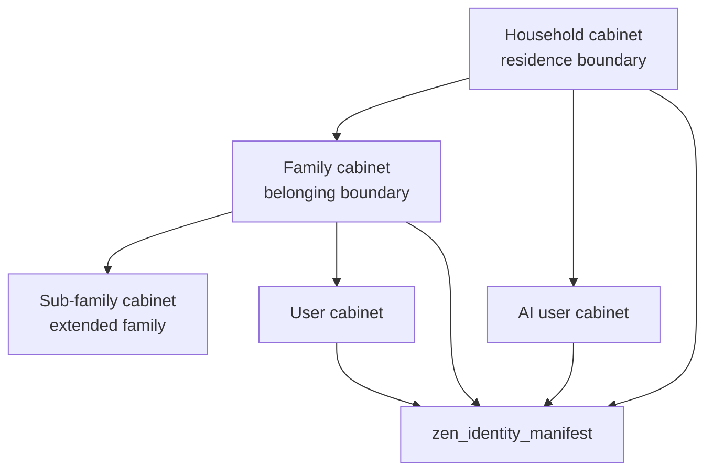

# Zen DojoTools Identity — v5.14.1

*Identity resolution, presence, and household/family group management for ZenOS-AI*

---

> **Backstage pass required (2026.11.0).** An agent without `zenos.agent.basic` gets this tool's `help`, `tool_manifest` and `kfc_manifest` only; `whoami` (a trimmed view), `resolve_caller_identity` and `request_live_ack` stay open, because every other tool's cert checks and live acks go through them. Anything else answers `status: error`, `reason: "guarded: onboarding_required: ..."` and `next_step: {tool: zen_flynn_oobe, mode: run}`, and writes one `zen_entry_gate` warning to the system log. Calls no user started (boot, Flynn, automations, the scheduler) pass. See [the onboarding gate](../developer_standards.md#the-onboarding-gate).

## Overview

`zen_dojotools_identity` is the identity resolver and group management tool for ZenOS-AI.

It handles two distinct concerns:

**Resolution** (`resolve`, `prompt`) — looks up registered users, AI constructs, or cabinets and returns identity records. Stateless, no side effects. Used by the AI prompt pipeline and MCP callers.

**Group management** — all household and family membership operations: adding and removing members, wiring families into households, linking delegation partners, and querying the membership graph. These modes write to cabinet drawers and fire events.

The tool is **MCP-exposed**. Resolution modes are safe to call at any time. Write modes are idempotent where noted.

---

## The Identity Model

```
System
  └─ Household (occupancy — "lives here")
       └─ Family (belonging — "part of this unit")
            └─ Sub-family (extended family — not on-premises)
```

**Household membership = residence.** In the household's `members` list means you occupy that space.

**Family membership = belonging.** Being in a family means you're part of that unit.

**Depth rule:** Families nest arbitrarily deep in the data model. Security resolution only chases 2 levels — `is_member(A, B)` checks: is A directly in B? Or is A in C which is directly in B? Anything deeper is not resolved for security purposes.

**Principal slots:** Each household and family has two privileged occupant slots in its VolumeInfo ACL record:
- `acls.owner` — Head of Household (HoH) for a household; primary user for a family
- `acls.prime` — Prime AI partner

These slots fill on first add and block re-entry. Use `set_principal` to transfer them.

**The ACL record (v2).** Every cabinet's VolumeInfo carries `acls: {v: 2, owner, prime, partners, ops}`. Principals are cabinet GUIDs (the VolumeInfo `id`), never names or entity_ids. `ops` holds the access rules FileCabinet enforces (see [FileCabinet access control](zen_dojotools_filecabinet_readme.md#access-control-acl-v2)). Family membership lives in the `members` drawers, not in the ACL. The vault cabinet is identity-only: other tools ask Identity, and Identity answers verdicts, never vault contents. Read the record only through `CABS.acl_record` / `acl_for` and `ID.principals`; Identity writes it through the admin door's `merge`, touching only the changed keys.

**Partner = delegation authority.** `acls.partners` records who is authorized to delegate on an entity's behalf. This is a governance relationship, not a social one. No token is issued without an explicit allow — the link records who has delegation authority, it does not grant it automatically. Works for any entity pair (user↔user, user↔AI, AI↔AI).



---

## Modes

| Mode | Description | Writes? |
|---|---|---|
| `resolve` | Returns identity record for target, or full roster if no target. A record carries `name`, `person_entity`, `member_type` and `memberships` (each container the member belongs to, with its type, role and depth); a person is found anywhere in the household tree. | No |
| `whoami` | Shared "who is asking" resolver. Human: `console_user`, `resolved_person`, `is_hoh` (from the household cabinet ACLs, never a label; informational only). Agent: `agent`, `agent_entity`, `agent_onboarded`, `is_default`, `is_prime`. Both: household and family memberships. Other tools call this rather than re-deriving identity. Before the agent holds `zenos.agent.basic`, a call with a user gets only the agent (`agent`, `agent_entity`, `agent_onboarded`, `has_basic: false`) and `next_step: zen_flynn_oobe mode=run`; internal calls get the full view. Code that needs the console user before approval reads `context.user_id` itself. | No |
| `prompt` | Returns rendered prompt capsule for target construct | No |
| `build_identity_manifest` | Builds `{roster, tree}` and writes to household cabinet | Yes |
| `household_add_family` | Wires a family cabinet into the household `members.families` list | Yes |
| `household_remove_family` | Removes a family cabinet from the household members list | Yes |
| `household_add_member` | Adds a user or AI to household; fills HoH/prime slot on first add | Yes |
| `household_remove_member` | Removes a user or AI from household | Yes |
| `set_principal` | Sets or replaces the HoH or prime AI slot for a household or family | Yes |
| `family_add_member` | Adds a user, AI, or sub-family to a family; sets default family on first join | Yes |
| `family_remove_member` | Removes a user, AI, or sub-family from a family | Yes |
| `link_partners` | Adds each entity's GUID to the other's `acls.partners` (bidirectional delegation link) | Yes |
| `unlink_partners` | Removes each entity from the other's `acls.partners` | Yes |
| `set_default_family` | Patches `default_family_guid` on a member's VolumeInfo | Yes |
| `membership` | Tree view for containers; reverse lookup for members | No |
| `is_member` | Depth-2 boolean check — is entity A a member of container B? | No |
| `provision_member` | Full orchestration — provision expansion slot, wire into family, rebuild manifest. Takes the first free slot (no user drawers, not an expansion slave), keeps `profile_payload` fields and the person link | Yes |
| `resolve_caller_identity` | Platform-wide SP1 identity/cert-check chokepoint — delegates to `zen_root_authentik`, enforces the OS sim_mode policy, optionally runs a cert check on the caller's behalf | No |
| `request_live_ack` (2026-08-15) | Single shared chokepoint for "get a live human yes/no" — fires an alert via AlertManager, polls for response, returns approved/declined/timeout. The console override approves at once | No |
| `cert_list` (2026-08-15) | Combined cert catalog + live-grant view — what could exist, and what's actually held right now | No |
| `cert_cache_refresh` | Internal (Flynn, the scheduler's script reload), not in the MCP mode list. Rebuilds the cert catalog cache in the vault when it is stale (a day old, or older than HA's start), or always with `force_refresh: true`. No vault: `skipped`, nothing cached | No |
| `acl_migrate` | Brings every cabinet's VolumeInfo to the ACL v2 record and repairs bad identity data. Dry run by default | Yes |
| `acl_set` | The owner changes `ops` on a cabinet's or a drawer's ACL | Yes |
| `take_ownership` | Escape hatch: makes the caller the ACL owner (or rewrites a drawer's ops). Cert + live ack on every call, audited | Yes |

**Schema gate.** `household_add_family`, `household_add_member`, `set_principal`, `family_add_member` and `provision_member` refuse with `code: acl_schema_upgrade_required` (with `cabinet`, `why` and `next_steps`) when their household or family is still on the old ACL schema. `force_action: true` upgrades that cabinet first, then continues; a failed upgrade answers `acl_schema_upgrade_failed`. Flynn passes `force_action`.

A call with no mode and no input returns the tool's roots (`who`, `belongs`, `may`) and never acts; name `mode=resolve` explicitly.

---

## Input Fields

| Field | Type | Description |
|---|---|---|
| `mode` | select | Operation mode (see table above) |
| `user_label` | text | Label referencing a registered ZenOS-AI user (resolve/prompt only) |
| `user_cabinet` | entity (sensor) | Cabinet sensor entity_id (resolve/prompt only, planned) |
| `user_entity_id` | entity (person) | HA person entity_id (resolve/prompt only, planned) |
| `user_guid` | text | ZenOS-AI user GUID (resolve/prompt only, planned) |
| `member_entity` | entity (sensor) | Cabinet to add/remove as a member, or entity A for link_partners |
| `member_type` | select | `user`, `ai_user`, or `family` — type of member being operated on |
| `member_name` | text | Display name for the new member. Required for `provision_member`. |
| `profile_payload` | text (JSON) | Optional JSON string — additional profile fields for `provision_member` (first_name, last_name, pronouns, role, etc.) |
| `family_entity` | entity (sensor) | Family cabinet target (family ops, set_principal override) |
| `ai_entity` | entity (sensor) | Entity B for link_partners / unlink_partners |
| `household_entity` | entity (sensor) | Explicit household cabinet — overrides default resolver |
| `confirm_action` | boolean | `acl_migrate`: required (with `dry_run: false`) to apply. `set_principal`: required when the target HoH/prime slot is already occupied by a **different** entity than `member_entity`. Not required to fill an empty slot or re-set the same entity already occupying it. Default `false` |
| `required_cert` | text | `resolve_caller_identity` only. Cert name to check on the caller's behalf (e.g. `zenos.infra.container_control`). When set, the mode runs the `cert_list` lookup itself against the resolved identity and returns `authorized: true/false` — the caller never touches `persona_editor` directly |
| `required_cert_level` | number | `resolve_caller_identity` only. Minimum cert level needed when `required_cert` is set. Default `1` |
| `dry_run` | boolean | `acl_migrate` only. `true` (default) plans and writes nothing |
| `force_action` | boolean | Setup modes: upgrade an old-schema household or family first instead of refusing. Default `false` |
| `drawer_key` | text | `acl_set` / `take_ownership`: a drawer in `target_entity` whose own ACL to change. Omit for the cabinet's ACL |
| `acl_ops` | object | `acl_set` / `take_ownership`: `{r\|w\|d\|a: {who: [...], cert: 'name:level', ack: bool}}`. Each op named replaces that op; the others are kept |
| `reason` | text | `take_ownership` (required) and `acl_set`: recorded in the audit event and shown in the live ack |
| `target_entity` (2026-08-16) | text | `acl_migrate`: one cabinet (default every `zen_cabinet`). `acl_set` / `take_ownership`: the target cabinet. `resolve_caller_identity`: optional, pairs with `required_cert`. The specific entity the caller wants to act on. When passed, this mode resolves `scope_decision` (`allow`/`deny`/`default`) internally via the shared `cert_scope_check` macro against the held cert's `cert_scope` — consumers stop walking `cert_scope` themselves. Omit it and `scope_decision` is always `default`, unaffected for any existing caller that doesn't pass it. |

**Resolution priority** (resolve/prompt modes):
```
user_label → user_cabinet → user_entity_id → user_guid
```

**Multi-household:** All household ops default to `sensor.zen_default_household_cabinet_resolved`. Pass `household_entity` to target a specific household cabinet.

---

## Mode Reference

### `resolve` / `prompt`

Stateless identity lookup. `resolve` returns the identity record; `prompt` returns the rendered prompt capsule.

```yaml
# Full roster — omit all target fields
zen_dojotools_identity:
  mode: resolve

# Specific target
zen_dojotools_identity:
  mode: resolve
  user_label: primary_user
```

**v4.7.0 — Person response additions:**

`cabinet` and `person_entity` are now explicit top-level keys in the person response (previously absent).

A `presence` block is included for all person targets:

```json
"presence": {
  "person_entity": "person.<entity_id>",
  "zone":          "home",
  "at_home":       true,
  "area_id":       null,
  "area_name":     ""
}
```

Consent gating — all fields require explicit opt-in in `_user_profile.tracking`:

| Field | Gate |
|-------|------|
| `zone`, `at_home` | `tracking.gps_zone: true` |
| `area_id`, `area_name` | `tracking.room: true` |

When consent is absent the field returns `"consent_required"` — never `null`, never silently dropped.

`area_id` returns `null` when the person's device tracker has no room assignment in the HA device registry. This is a HA configuration gap, not a code gap — assign the tracker to a room and room-level presence goes live with no code changes.

**Tracking consent setup:**

Write to `_user_profile` in the user's cabinet via FileCabinet `mode: update`:

```json
"tracking": {
  "gps_zone": true,
  "room": true
}
```

**Reverse residents (mode=resolve with area target):**

Each resident entry in `_r3b_reverse_residents` now includes `person_entity` and a consent-gated `zone` field.

---

### `build_identity_manifest`

Builds the identity manifest and writes `{roster, tree}` to the `zen_identity_manifest` drawer in the household cabinet. The tree is the depth-2 household membership structure including principal slots.

```yaml
zen_dojotools_identity:
  mode: build_identity_manifest
```

Can also be triggered via event:
```
zen_event kind: identity_manifest_rebuild
```

**Response:** `{result: ok, manifest_written: true, timestamp}`

---

### `household_add_family`

Wires a family into the household's `members.families` list at depth 1. Family members become household residents by graph traversal.

```yaml
zen_dojotools_identity:
  mode: household_add_family
  family_entity: sensor.<family_cabinet>
```

---

### `household_remove_family`

Removes a family from the household members list.

```yaml
zen_dojotools_identity:
  mode: household_remove_family
  family_entity: sensor.<family_cabinet>
```

> ⚠️ **Family teardown order matters.** `deprovision` does NOT remove a family from the household. Skipping `household_remove_family` before deprovisioning leaves a stale entry in `members.families` — re-provisioning and re-adding the family then creates a duplicate.
>
> Correct teardown sequence:
> 1. `family_remove_member` for each member
> 2. `household_remove_family`
> 3. Deprovision member cabinets
> 4. Deprovision family cabinet

---

### `household_add_member`

Adds a user or AI to the household.

```yaml
zen_dojotools_identity:
  mode: household_add_member
  member_entity: sensor.<cabinet>
  member_type: user   # or ai_user
```

**First occupant behavior:**
- First `user` → also fills `acls.owner` (Head of Household slot)
- First `ai_user` → also fills `acls.prime`

**Occupied slot:** If the HoH or prime slot is already filled, add is blocked with `slot_occupied` error. Use `set_principal` to transfer the slot.

**Already a member, slot still free:** If `member_entity` is already in the household's `members` list but the HoH/prime slot was never filled (e.g. an earlier call added membership but failed before filling the slot, or the slot was cleared some other way), the call falls through and fills the slot instead of dead-ending on `already_member` — only a direct `set_principal` call could previously unblock this case.

**Response includes** `slot_filled: hoh | prime | ''`.

**Event fired:** `zen_event kind: household_member_joined`

---

### `household_remove_member`

Removes a user or AI from the household.

```yaml
zen_dojotools_identity:
  mode: household_remove_member
  member_entity: sensor.<cabinet>
  member_type: user   # or ai_user
```

Does **not** clear the `acls.owner` or `acls.prime` slots — those require `set_principal`.

**Response includes** `principal_warning: hoh_slot_stale | prime_slot_stale | ''` — warns if the removed member held a principal slot.

**Event fired:** `zen_event kind: household_member_left` with `principal_warning` field.

---

### `set_principal`

Sets or replaces the Head of Household or prime AI slot for a container cabinet.

```yaml
zen_dojotools_identity:
  mode: set_principal
  member_entity: sensor.<cabinet>
  member_type: user      # user → fills/replaces acls.owner (HoH)
                         # ai_user → fills/replaces acls.prime
  # family_entity: sensor.<family_cabinet>  # optional — targets family instead of default household
  # confirm_action: true  # required only when replacing a DIFFERENT existing occupant
```

**Default target:** `zen_default_household_cabinet`. Pass `family_entity` to target a specific family cabinet instead.

**Takeover gate:** Filling an empty slot, or re-setting the same entity already occupying it, needs no confirmation. Replacing a slot already occupied by a **different** entity requires `confirm_action: true` — prevents a confused or compromised caller silently taking over an established household. Without it, the call errors with `code: confirm_required`.

**Replacement:** Previous occupant of the slot is replaced, and the new principal is dropped from `partners` if it was there. Other partners are preserved.

**Members sync:** `set_principal` also adds `member_entity` to the target cabinet's `members` list if not already present (deduped) — keeping `members` and `acls` in sync the same way `household_add_member` does, so a caller using `set_principal` directly doesn't leave a principal pointer that a membership-based staleness check would wrongly flag as orphaned.

**Event fired:** `zen_event kind: principal_changed`

---

### `family_add_member`

Adds a user, AI, or sub-family to a family.

```yaml
zen_dojotools_identity:
  mode: family_add_member
  family_entity: sensor.<family_cabinet>
  member_entity: sensor.<cabinet>
  member_type: user   # user | ai_user | family
```

**Default family:** If this is the member's first family (no `default_family_guid` set), this family is automatically set as their default.

**Sub-families:** `member_type: family` wires in a sub-family at depth 2. Sub-family members are extended family — not household residents.

Membership lives in the family's `members` drawer; nothing is written to the member's ACL.

**Event fired:** `zen_event kind: family_member_joined` with `prompt_profile_update: true`

---

### `family_remove_member`

Removes a user, AI, or sub-family from a family.

```yaml
zen_dojotools_identity:
  mode: family_remove_member
  family_entity: sensor.<family_cabinet>
  member_entity: sensor.<cabinet>
  member_type: user   # user | ai_user | family
```

**Default family cleanup:** If the removed family was the member's `default_family_guid`, that field is cleared. The member must explicitly set a new default via `set_default_family`.


**Response includes** `principal_warning` and `was_default_family` fields.

**Event fired:** `zen_event kind: family_member_left` with `was_default_family` and `principal_warning` fields.

---

### `link_partners`

Adds each entity's GUID to the other's `acls.partners`. Works for any entity pair (user↔user, user↔AI, AI↔AI).

```yaml
zen_dojotools_identity:
  mode: link_partners
  member_entity: sensor.<cabinet_a>   # any type: user, ai_user
  ai_entity: sensor.<cabinet_b>       # any type: user, ai_user
```

Idempotent — re-running does not create duplicate entries.

**Event fired:** `zen_event kind: partner_linked`

---

### `unlink_partners`

Removes each entity from the other's `acls.partners`. Symmetric.

```yaml
zen_dojotools_identity:
  mode: unlink_partners
  member_entity: sensor.<cabinet_a>
  ai_entity: sensor.<cabinet_b>
```

**Event fired:** `zen_event kind: partner_unlinked`

> **4.5.6 fix:** Prior to 4.5.6 the ACL removal was a silent no-op — the mode computed `_a_vi_updated`/`_b_vi_updated` but the write events referenced undefined variable names. Both writes now correctly persist the updated VolumeInfo.

---

### `set_default_family`

Patches `default_family_guid` in the member's VolumeInfo. The first family joined sets this automatically; use this to change it explicitly.

```yaml
zen_dojotools_identity:
  mode: set_default_family
  member_entity: sensor.<user_or_ai_cabinet>
  family_entity: sensor.<family_cabinet>
```

---

### `membership`

Read-only graph query. Two behaviors depending on entity type:

**Container entity** (household, family) → returns depth-2 tree:

```yaml
zen_dojotools_identity:
  mode: membership
  member_entity: sensor.<household_or_family_cabinet>
```

Returns: `{principals: {hoh, prime}, members: {users, ai_users}, families: [{..., subfamilies: [...]}]}`

**Member entity** (user, ai_user) → returns reverse lookup: which households and families is this entity in?

```yaml
zen_dojotools_identity:
  mode: membership
  member_entity: sensor.<user_or_ai_cabinet>
```

Returns: `{household_memberships: [...], family_memberships: [...]}`

---

### `is_member`

Depth-2 boolean membership check.

```yaml
zen_dojotools_identity:
  mode: is_member
  member_entity: sensor.<entity_to_check>
  family_entity: sensor.<container_to_check_against>   # household or family
```

Returns: `{is_member: true|false, depth: 1|2|null}`

- `depth: 1` — direct member of the container
- `depth: 2` — member of a sub-family that is directly in the container
- `depth: null` — not a member at either depth

---

### `provision_member` — Full Orchestration (v5.0, closes #135)

Single-call path for adding a family member who has no HA `person.*` entity and no pre-provisioned cabinet. Handles the full lifecycle: find slot → provision → wire → rebuild.

```yaml
zen_dojotools_identity:
  mode: provision_member
  member_name: Marianne
  profile_payload: '{"first_name": "Marianne", "role": "extended_family", "pronouns": "she/her"}'
  # family_entity: sensor.<cabinet>   # optional — defaults to zen_default_family_cabinet_resolved
  # member_type: user                 # optional — default: user
```

**What it does:**
1. Validates `member_name` (required — hard-stop if missing)
2. Resolves `family_entity` (defaults to `sensor.zen_default_family_cabinet_resolved`)
3. Scans expansion slots `sensor.zenos_expansion_cabinet_1` through `_5` for the first in `init` state
4. Hard-stops with clear error if all 5 slots are occupied
5. Calls the provisioner — auto-stamps `init` → provisions as `user` (or `member_type`) with `preferred_name` + `name` seeded from `member_name`, merged with any `profile_payload` fields
6. Hard-stops if provisioner fails
7. Calls `family_add_member` to wire the new cabinet into the target family
8. Returns combined response

**Response:**
```json
{
  "mode": "provision_member",
  "status": "ok",
  "member_name": "Marianne",
  "member_entity": "sensor.zenos_expansion_cabinet_2",
  "member_type": "user",
  "family_entity": "sensor.zenos_default_family_cabinet",
  "provisioner_result": { "status": "success", "cabinet": "...", "guid": "..." },
  "family_result": { "status": "ok", "family_entity": "...", "member_entity": "..." }
}
```

`status: partial` is returned if the provisioner succeeded but `family_add_member` failed — the cabinet exists but is not wired. Inspect `family_result` for the specific error.

**Before v5.0:** Adding a person with no HA account required finding a stacks slot manually, calling the provisioner, writing profile data via the profile editor (which was silently failing its own write gate), calling `family_add_member`, and rebuilding the manifest. After a restart, the person would be an orphan in the manifest.

**OOBE:** `flynn_oobe.yaml` step `3_people` now routes external family members (no HA person entity) through `provision_member` automatically.

---

### `resolve_caller_identity` — SP1 Identity/Cert Chokepoint (v5.4.0)

The platform-wide call-site for identity resolution under SP1. Delegates to `zen_root_authentik` (currently a stub — no real Authentik/OIDC yet) and enforces the OS-level sim_mode policy in one place, so individual tools don't each implement their own gate.

```yaml
zen_dojotools_identity:
  mode: resolve_caller_identity
  # required_cert: zenos.infra.container_control   # optional
  # required_cert_level: 2                   # optional, default 1
```

**Sim_mode policy gate:** Reads `integrations_config.identity.sim_mode_allowed` from the default household cabinet (stamped by `zen_admintools_prompt_loader` on every factory run — default `false`, fail-closed).

| `zen_root_authentik` result | `sim_mode_allowed` | Outcome |
|---|---|---|
| `sim_mode: true` (simulated) | `false` (default) | **Blocked** — `resolved_identity` withheld |
| `sim_mode: true` (simulated) | `true` | Allowed |
| `sim_mode: false` (real) | — (irrelevant) | Always allowed |

**Optional cert check:** If `required_cert` is set (and the identity resolution was not blocked), this mode calls `zen_dojotools_persona_editor mode=cert_list` against the resolved identity itself and folds the result into the response as `authorized`. Consumers must call this mode for cert checks instead of calling `persona_editor` directly — checking your own cert against your own resolved identity defeats the point of a single chokepoint.

**Optional scope resolution (2026-08-16):** if `target_entity` is also set, this mode additionally resolves `scope_decision` — `allow`/`deny`/`default` — via the shared `cert_scope_check` macro (`zen_os_1.jinja`) against the held cert's `cert_scope`. This happens once, here, not re-walked per consumer tool: locks/covers/security_manager/room_manager/infra/ZenLux all read `scope_decision` straight off this response instead of each independently testing `entity_id in cert_scope`. Identity's job is only to surface the decision, never to interpret what a tool should do with it — each consumer still owns deciding whether `scope_decision: allow` means "skip a live ack" for its own action.

**Response shape:**

```json
{
  "mode": "resolve_caller_identity",
  "policy_status": "allowed",
  "sim_mode": true,
  "sim_mode_allowed": false,
  "override_attempted": false,
  "token_shape": "none",
  "resolved_identity": { "...": "withheld when policy_status is blocked" },
  "block_reason": "",
  "cert_checked": false,
  "cert_name": "",
  "cert_level": 0,
  "cert_required_level": 1,
  "cert_scope": [],
  "cert_constraints": [],
  "target_entity": "",
  "scope_decision": "default",
  "authorized": true,
  "caller_token_received": "",
  "timestamp": "..."
}
```

`block_reason` is populated only when `policy_status: blocked` (`"sim_mode result rejected: OS policy integrations_config.identity.sim_mode_allowed is false"`). `authorized` is `true` only when the identity was not blocked **and** any requested cert check passed — consumers should gate on `authorized`, not `policy_status` alone, when a cert was requested. `scope_decision` is independent of `authorized` — a caller can be `authorized: true` (holds the cert at the required level) with `scope_decision: default` (no scope override for this specific target), which is the normal case for a live-ack-tier action with no admin exemption granted.

### `request_live_ack` — Shared Live-Approval Chokepoint (2026-08-15)

Extracted after the same ~40-line fire-and-poll block turned up hand-rolled four times (`zen_dojotools_infra`'s Portainer d-class ack, `zen_dojotools_locks`' `escalation_request`, `zen_dojotools_persona_editor`'s `cert_grant` and `cert_revoke`). Same "call identity, don't re-derive your own logic" principle as `resolve_caller_identity` — this is the ack-flow equivalent. One-shot per call: fires an alert, polls for a response, returns `approved`/`declined`/`timeout`. Callers that need a *time-boxed grant* (not just one action's approval) still own writing that grant to their own cabinet drawer after a true response here, same as `zen_dojotools_locks`' `escalation_request` does.

```yaml
zen_dojotools_identity:
  mode: request_live_ack
  ack_message: "Agent requests X. Approve?"     # required
  # ack_key: my_custom_key                       # optional, default: live_ack_<timestamp>
  # ack_max_wait_seconds: 90                      # optional, default 90, hard-capped at 150 regardless of input
  # ack_poll_interval_seconds: 15                 # optional, default 15, floored at 5
  # ack_notify_target: postman                    # optional, default 'postman' — see notify_target note below
```

**`ack_max_wait_seconds` is hard-capped at 150 in code, regardless of caller or cabinet input** — a longer approval window is a de-escalation attack surface, so this isn't tunable past that ceiling by design.

**`notify_target` must be `postman`.** Only `'postman'` wires `response_type`/yes-no capture through `zen_dojotools_postman` (cached in the kata cabinet as `alert_response_<key>`, which `get_response` reads). `'mobile'` was the long-standing default across all four original hand-rolled call sites and silently falls through to a literal `notify.mobile` service call that doesn't exist — **every ack request on every one of those four call sites had been failing closed by accident, not by design, since the first one was built.** Fixed at this single default; not yet verified end-to-end with a real live approval (avoid firing an unnecessary real push before you need to).

**Response shape:**

```json
{
  "status": "ok",
  "mode": "request_live_ack",
  "approved": true,
  "reason": "approved",
  "waited_seconds": 15,
  "caller_token": "..."
}
```

`reason` is one of `approved`, `declined`, `timeout`, `dispatch_failed` (alert never fired — `approved: false`, `waited_seconds: 0`, no polling attempted), or `console_bypass`.

**Console override.** While the `cert_admin_console_bypass` drawer on the system cabinet is thrown (only by hand, from the console), every live ack answers at once: `approved: true`, `reason: console_bypass`, `waited_seconds: 0`. Every caller that asks for a live ack (hammer, reset, reset_all, take_ownership and the rest) follows it, because this is the one place it is applied. Each use is audited (`zen_event live_ack_console_bypass` and a system_log warning). On an offline install it is the only approval there is. A cabinet wipe clears it.

### `acl_migrate` — Bring Every Cabinet to ACL v2

```yaml
zen_dojotools_identity:
  mode: acl_migrate
  # target_entity: sensor.my_cabinet   # optional, default every zen_cabinet
  # dry_run: false                     # default true
  # confirm_action: true               # required to apply
```

Run it as a dry run first and review the plan, then apply it. Check every proposed `class`, especially any cabinet the plan calls `scratchpad` (the open row). Apply re-reads every cabinet it touched; a second run should report 0 changes. Identity setup needs it (see the schema gate above). Flynn's bootstrap runs it until the schema stamp is current, and `zen_dojotools_systemtools tool=cabinet_schema_upgrade` runs it when the stamp is behind.

What it repairs:
- a missing `id` (a legacy `guid` field becomes the id)
- v1 owner and partner lists, converted to GUIDs
- `acls.family` and "default-guid" placeholders, dropped
- missing `flags` or `friendly_name`
- `members` entries whose guid isn't their cabinet's
- stray VolumeInfo copies (`ai_cabinet_volumeinfo`, `_ai_cabinet_volumeinfo`): a copy holding an id fills what's missing, and every copy is removed

What it stamps:
- each cabinet's `class` (`system`, `vault`, `dojo`, `kata`, `history`, `household`, `family`, `user`, `ai_user`, `scratchpad`), proposed from its labels once; after that only the admin door changes it, and the gate never reads labels
- the kata cabinet's owner (the default agent) when it has none
- after a clean full apply, `acl_schema: {version, migrated}` on the system cabinet. A cabinet skipped because nothing loaded is reported but doesn't hold the stamp back

Answer fields: `status` (`dry_run` / `ok` / `error`), `schema_stamped`, `scanned`, `changed`, `changes` (each `{cabinet, patch, unset, remove, members, notes}`), `clean`, `dangling` (`{cabinet, guid}` principals that resolve to no cabinet, reported and never dropped), `skipped` (cabinets that can't be read) and `remaining` (cabinets still failing the schema check after apply).

### `acl_set` — Change a Cabinet's or Drawer's Ops (owner only)

```yaml
zen_dojotools_identity:
  mode: acl_set
  target_entity: sensor.my_cabinet
  # drawer_key: some_drawer            # omit for the cabinet's ACL
  acl_ops: {"w": {"who": ["@owner"], "cert": "", "ack": false}}
  reason: "lock writes to the owner"
```

Only the cabinet's owner may call it. Refusal codes: `invalid_request`, `caller_unresolved`, `not_owner`. Audited as `zen_event acl_changed` with the old and new ACL.

### `take_ownership` — The Escape Hatch

```yaml
zen_dojotools_identity:
  mode: take_ownership
  target_entity: sensor.my_cabinet
  reason: "previous owner is gone"     # required
  # drawer_key: some_drawer
  # acl_ops: {...}
```

Needs cert `zenos.identity.acl_take_ownership` and a live ack on every call (the console override stands in for the ack). On a cabinet, the caller becomes the ACL owner and `acl_ops` replaces the named ops. On a drawer, the drawer's ops become `acl_ops`; empty means inherit from the cabinet. Only the ACL is rewritten, never the value.

**Expansions.** An expansion's cabinet ACL is its host's, so `acl_set` and `take_ownership` on an expansion cabinet are refused, and the refusal names the host to set it on. A drawer `expand_drawer` moved keeps its own ACL, so a drawer-scope call on that key in the host writes the drawer's ACL on the copy in the expansion, where the drawer lives.

Answer fields: `status`, `target`, `old_acl`, `new_acl`, `approver` (`live_ack`, `console_bypass` or `owner`). Refusal codes: `invalid_request`, `caller_unresolved`, `cert_required`, `ack_declined`, `ack_not_approved`. Audited as `zen_event acl_ownership_taken`.

### `cert_list` — Combined Cert Catalog + Live-Grant View (2026-08-15)

"What could exist, and what do I actually hold right now." Combines the cert catalog (`zen_dojotools_manifest mode=cert_audit`: every cert any tool declares, with its short `description`, its `detail` and its `max_level`) with the live grant roster from `zen_dojotools_persona_editor`'s own `cert_list`, so a caller gets one answer instead of cross-referencing two tools.

- **The catalog is cached in the vault.** When exactly one cabinet carries `zen_vault_cabinet` and it is online, the catalog comes from `zen_cert_catalog` there, read through the admin door. Otherwise it is built live and nothing is cached. `catalog_source` says which (`cache` or `live`); `force_refresh: true` builds it live and refreshes the cache. Grants are always read live.
- **Dates.** A grant made in 2026.11.0 or later shows `not_before` and `not_after` (one year), in UTC. Nothing enforces expiry yet.
- **Renamed certs.** A grant held under a cert's pre-2026.11.0 flat name shows as held, with `reissue_pending`, until 2026.12. The alias map is `cert_aliases()` in `zen_identity.jinja`.
- **Notes.** When one applies, `cert_list` answers with a plain `notes` list: how many grants are still under an old name (they work for now; asking for the new name at the same level reissues them), and any grant held above its cert's `max_level`. The agent's prompt carries nothing about certs, so this is where it learns its grant state.

Gated on `resolve_caller_identity` returning `policy_status: allowed` — no specific cert required, no live ack. Reading your own current permission state isn't dangerous the way granting/revoking is (that's why `cert_grant`/`cert_revoke` get the full catalog-plus-live-ack treatment and this doesn't), but it isn't wide open to a caller whose identity resolution is itself blocked either.

```yaml
zen_dojotools_identity:
  mode: cert_list
```

---

## Onboarding Sequence (Standard)

When provisioning a fresh system, the recommended identity wiring sequence:

1. Mint household — provision `cab_type: household`
2. Add family to household — `household_add_family`
3. Mint user — provision `cab_type: user`
4. Add user to family — `family_add_member` (first family auto-sets `default_family_guid`; user fills HoH slot in household)
5. Mint AI user — provision `cab_type: ai_user`
6. Add AI to household — `household_add_member` (first AI fills the prime slot)
7. Link user and AI — `link_partners` (bidirectional delegation link)
8. Optionally invite AI into family — explicit `family_add_member`; fires join event

Flynn bootstrap (`flynn_bootstrap_content`) runs steps 4–7 automatically on first boot. As of 4.5.6, Flynn also calls `household_add_family` and `family_add_member` during bootstrap to wire the default family into the household graph — closing a gap where cold builds left the family cabinet as an orphan.

> **Name resolution (4.5.6):** The identity tree builder and manifest now use a three-step fallback chain: `friendly_name → name → entity_id`. Pre-RP2 VolumeInfo entries that stored the display name in a `name` field (not `friendly_name`) now resolve correctly in the membership tree and manifest output.

---

## Valid Identity Surface

A valid identity is more than a profile drawer. It requires a cabinet role, profile data, membership edges, and a manifest rebuild.

| Identity Kind | Must Have | Written By |
|---|---|---|
| Person/User | User cabinet role label, `_user_profile`, optional HA `person.*`, family membership when joined | Provisioner, Profile Editor, Identity |
| Family | Family cabinet role label, optional `_family_profile`, `members` drawer | Provisioner, Profile Editor, Identity |
| Household | Household cabinet role label, `_household_profile`, `members` drawer, HoH owner, prime AI partner | Flynn, Profile Editor, Identity |
| AI User | AI user cabinet role label, `zenai_essence`, optional family membership and partners | Provisioner, Profile Editor, Identity |

The membership graph is valid when:

- household `members.families[]` contains the family cabinets that belong to the household
- family `members.users[]`, `members.ai_users[]`, and `members.families[]` reflect current membership
- every cabinet's VolumeInfo has an `id` and an ACL v2 record (`acl_migrate` reports 0 changes)
- member VolumeInfo `default_family_guid` is set when a default family exists
- household VolumeInfo `acls.owner` holds the Head of Household's GUID
- household VolumeInfo `acls.prime` holds the prime AI's GUID
- `zen_identity_manifest` has been rebuilt after membership changes

See [Cabinet Specification](../cabinets/cabinet_spec.md#101-valid-identity-cabinet-shapes) for the drawer-level shapes and [Profile Editor](zen_dojotools_profile_readme.md#valid-profile-structures) for the profile writer.

---

## Events Reference

| Event | Mode | Key Fields |
|---|---|---|
| `household_member_joined` | `household_add_member` | `member_entity`, `member_type`, `slot_filled` |
| `household_member_left` | `household_remove_member` | `member_entity`, `member_type`, `principal_warning` |
| `principal_changed` | `set_principal` | `member_entity`, `member_type`, `target_cabinet`, `previous_principal` |
| `family_member_joined` | `family_add_member` | `member_entity`, `member_type`, `family_entity`, `prompt_profile_update: true` |
| `family_member_left` | `family_remove_member` | `member_entity`, `family_entity`, `was_default_family`, `principal_warning` |
| `partner_linked` | `link_partners` | `entity_a`, `entity_b` |
| `partner_unlinked` | `unlink_partners` | `entity_a`, `entity_b` |

---

## Three-Plane Navigation (v4.7.0)

The ZenOS identity cabinet, HA `person.*` entity, and HA area are fully navigable from any direction. This is the "lens pivot" — start anywhere, reach the other two planes.

| Start | Reach |
|-------|-------|
| `resolve('<user_label>')` | → `area_id`, `area_name`, `zone`, `at_home`, `person_entity` |
| `inspect(person.<entity>)` | → full identity overlay with presence block (see Inspect docs) |
| `resolve` with area target | → residents with `person_entity` + consent-gated `zone` |
| Inspect `person_list` | → all persons; ZenOS users with full profile + presence |

`identity: null` for persons without a `zen_user_cabinet`-labeled cabinet is correct — provisioning a cabinet lights them up with no further code changes.

---

## Template Surface — `zen_identity.jinja`

A Jinja2-callable identity resolver lives at `custom_templates/zenos_ai/zen_identity.jinja`. Same contract as the script surface but callable from sensors, cortex macros, and command interpreter contexts where `action:` calls are unavailable.

```jinja


...
```

**Always call `| from_json`** — the macro returns a tojson string, not a native dict.

Other macros (v1.5.0):

| Macro | Returns |
|---|---|
| `principals(cab)` | `{hoh, prime}`, each `{guid, entity_id}` or null, read from the ACL record |
| `caller(required_cert='', required_level=1)` | `{entity_id, guid, policy_status, cert_checked, cert_ok, cert_level, cert_satisfied_by}`: Identity's caller answer and cert check without a script call. Follows `sim_mode_allowed` |
| `console_override()` | `'true'` or `'false'` |
| `member_index` | Membership index; roles match by GUID |

**Mobile note:** On the template surface, the `mobile` block returns `zone` and `battery` only. `entity_id`, `configured`, and `battery_entity` are available on the script surface only (require `state_attr` access not available in all Jinja2 contexts).

**When to use which surface:**

| Surface | Use when |
|---------|----------|
| Script (`zen_dojotools_identity`) | Inside scripts, automations, any context that can `action:` |
| Template (`zen_identity.jinja`) | Inside sensors, cortex macros, command interpreter — Jinja2-only contexts |

---

## Architectural Notes

### RecursionError in Loop Contexts

`zen_identity.jinja` **cannot be imported inside `for_each:` loops** or `variables:` steps that themselves execute inside loop contexts. HA's Jinja2 sandbox raises a RecursionError in nested import chains.

**Fix pattern:** Replace the Jinja2 import with a `script.zen_dojotools_identity` `action:` call inside the loop. The script executes in a separate HA context, bypassing the recursion constraint. This is the pattern used by `zen_dojotools_inspect` when enriching `person.*` entities.

---

## Dependencies

| Dependency | Purpose |
|---|---|
| `zen_os_1.jinja` → `identity_resolve_source()` | Full identity resolution pipeline — resolve/prompt modes |
| `zen_os_1.jinja` → `identity_roster()` | Full household roster — build_identity_manifest |
| `zen_os_1.jinja` → `identity_manifest_loader()` | Reads `zen_identity_manifest` from household cabinet |
| `zen_sutra_filecabinet` | Drawer reads and writes, naming `caller_tool: zen_dojotools_identity` |
| `zen_admintools_cabinet_writer` | VolumeInfo writes (`merge`, only the changed keys) |
| `zenos_cabinets.jinja` | `acl_record`, `acl_schema_check`, `volumeinfo_copies` |
| `zen_identity.jinja` | Template surface (Jinja2 contexts) — v1.5.0 |
| Household Cabinet | `members` drawer, `AI_Cabinet_VolumeInfo`, `zen_identity_manifest` |
| User / AI User / Family Cabinets | `AI_Cabinet_VolumeInfo.acls` — the v2 record |

---

## Cross-References

- [User Management](../getting_started/user_management.md) — operator workflow for provisioning and teardown
- [Profile Editor](zen_dojotools_profile_readme.md) — profile drawer writer
- [Cabinet Specification](../cabinets/cabinet_spec.md) — valid cabinet and identity shapes
- [Certification](../architecture/19_certification.md) and [Principals](../architecture/18_principals.md): current policy and caller-token status
- [Script Modules](readme.md) — return path to the internal tool map
