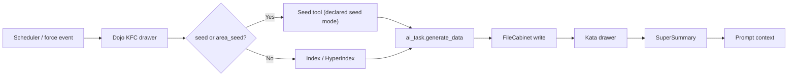

# Zen DojoTools Summarizers — Ninja Summarizer v5.6.0 · SuperSummary v4.9.0

*Ninja Summarizer + SuperSummary — the KF6 action pipeline — MCP-exposed*

---

> **Response envelope (2026.10.0):** `zen_dojotools_supersummary` and `zen_dojotools_ninja_summarizer` return the standard OS envelope — `{status, mode, tool, result, system_message, caller_token}` (see [`envelope()`](../custom_templates/zen_os1_jinja.md#envelopestatus-mode-result-tool-caller_token--canonical-response-shape)). The response fields documented on this page live under `result`; top-level `status` is the generic `success`/`error` execution status. Read `.result` when consuming a response via `response_variable`.

> **Backstage pass required (2026.11.0).** An agent without `zenos.agent.basic` gets this tool's `help`, `tool_manifest` and `kfc_manifest` only. Anything else answers `status: error`, `reason: "guarded: onboarding_required: ..."` and `next_step: {tool: zen_flynn_oobe, mode: run}`, and writes one `zen_entry_gate` warning to the system log. Calls no user started (boot, Flynn, automations, the scheduler) pass. See [the onboarding gate](../developer_standards.md#the-onboarding-gate).

## Overview

The summarizer package is the KF6 action pipeline. It runs continuously on a schedule, reads each component's context via HyperIndex, writes structured kata to the Kata cabinet, and synthesizes that knowledge into the `zen_summary` drawer that loads Friday's prompt context. Where a component's kata calls for action — a notification, an event, a dispatch — the pipeline fires it.

Two scripts ship in this package:

| Script | Role |
|---|---|
| `zen_dojotools_ninja_summarizer` | Per-component kata writer — reads one KFC component's context and writes its kata drawer |
| `zen_dojotools_supersummary` | Whole-home synthesizer — reads all active kata drawers and writes `zen_summary` |

**Pipeline order:** Ninja Summarizer → per-component kata drawers → SuperSummary → `zen_summary` → Friday's prompt

Both scripts are **MCP-exposed** for on-demand runs. The Scheduler drives them automatically.



---

## Kill Switches

Three `input_boolean` entities control the pipeline. Fresh installs default the master switch **off** so a new user does not accidentally run continuous background inference before choosing a local/background AI task.

| Entity | Default | Purpose |
|---|---|---|
| `input_boolean.zen_summarizers_enabled` | off on fresh install | Master gate — turns off both summarizers immediately |
| `input_boolean.zen_ninja_summarizer_enabled` | on | Ninja Summarizer individual kill switch |
| `input_boolean.zen_supersummarizer_enabled` | on | SuperSummary individual kill switch |
| `input_boolean.zen_action_emission_enabled` | off | Allows Ninja to emit `suggested_act_event` kinds onto the event bus. Operator-only — AI cannot write this boolean. Each act also needs the target tool's emit cert held with the Ninja emit stage (see [The responsible agent and its certs](#the-responsible-agent-and-its-certs)). |

Master is checked first. If the master is off, both summarizers exit regardless of their individual switches. Turning any switch off is non-destructive — no schedules, automations, or cabinet data are touched.

**Auto-refire on re-enable:** `automation.zen_pipeline_autofire_on_enable` fires the appropriate force event within seconds of any switch being turned back on — no waiting for the next scheduled run. See [Scheduler readme](zen_dojotools_scheduler_readme.md) for trigger IDs.

> **Warning:** Do not point `input_text.zenos_ai_task_entity` at a paid inference API. The Ninja Summarizer fires multiple times per hour; the SuperSummary fires a minimum of 4 times per hour. Use a locally-hosted model for background summarization. Your frontline conversation agent (demand-only) does not carry this risk.

---

## Ninja Summarizer

**Script:** `zen_dojotools_ninja_summarizer`

Summarizes a single Kung Fu Component. Called by the Scheduler for each component that subscribes to the current trigger ID.

### Input Fields

| Field | Required | Description |
|---|---|---|
| `kung_fu_component_id` | Yes | KFC component ID (will be slugified). Matches the drawer key in the Dojo cabinet. |
| `query` | No | Override the default summarization query. Use with caution. |
| `post_to_kata_cabinet` | No | Write result to Kata cabinet? Default: `false`. |
| `supplemental_prompt` | No | Extra data or instructions appended to the monk prompt. |
| `force` | No | Bypass the run governor (dedup burnout window). For admin overrides or emergency on-demand runs. Default `false`. |
| `area_id` | No | HA area ID. When set and the KFC defines `area_seed`, the `{{area_id}}` slot in `area_seed.params` is filled at runtime. Used for per-area rollup patterns. |
| `index_call_override` | No | Override the component's configured index call with a custom dict DSL for this single run. Does not persist. |
| `parent_component_id` | No | Component slug to treat as the logical parent of this run (for compound/nested component patterns). Echoed in the response for correlation. |
| `staleness_minutes` | No | If the component's last kata drawer is newer than this value, skip the monk call and return the cached kata. Sets `expires_after` on the kata write. Default: uses `staleness_minutes` from the KFC drawer if present, else no staleness check. |
| `caller_token` | No | Opaque pass-through token for correlation. |

### What It Does

1. **Kill switch check** — exits immediately if master or ninja switch is off
2. **AI task guard** — exits with error if `input_text.zenos_ai_task_entity` is unset or unavailable
3. **Resolve cabinets** — reads Dojo, Kata, and household cabinet entity IDs from resolver sensors
3a. **Responsible agent (4.7.0)** — the run acts as the agent responsible for the household: the prime in its ACL, else the default agent. If that agent isn't onboarded, the run stops with `reason: agent_not_onboarded` and the notification "ZenOS: summaries are paused".
4. **Read Dojo drawer** — loads the component's KFC metadata (friendly name, label, command, tool, kata_key)
5. **`meta.enabled` check** — exits with `reason: meta_disabled` if the component's `meta.enabled` is `false`
5a. **Minimum level (4.8.0, KF6)** — if the drawer's `meta.requires` names a cert at level 1 or more, the responsible agent must hold it at that level or higher, granted for stage `s`. Otherwise the run stops before the seed and the monk with `error: kfc_cert_required`, fires `pipeline_component_refused`, posts the notification `zen_kfc_cert_required_<slug>`, and keeps the last kata. The answer carries `required {cert, level, stage}`, `held {cert, level, stages}` and a message naming the gap.
6. **Run governor** — dedup burnout window check (see below). Exits with `reason: dedup_window` if blocked.
7. **Step 3c — Seed tool call (v4.3.0+)** — if the KFC defines `seed` or `area_seed`:
   - Resolves `_seed_tool`: `area_seed` takes priority when `area_id` input is set; falls back to `seed`.
   - **Declared-mode check (4.7.0)**: only an existing `zen_dojotools_*` script is asked, for its `tool_manifest`. The seed's mode (or `mode:case` when the params carry a `case`) must be in its `seed_modes`.
     - Declared → fires `script.{{ _seed_tool }}`, sets `_seed_used: true`, step 8 skipped.
     - Not declared → the run stops before the monk with `reason: seed_tool_not_authorized`, naming the declared modes.
     - 11 bridge, removed in 12: a tool on the old `zen_summarizer_seed_whitelist` that declares no `seed_modes` still seeds with any mode, stamped `legacy_seed_list`. A tool that declares `seed_modes` is checked strictly; the list can't widen it.
   - If neither `seed` nor `area_seed` is defined: step 3c is skipped, step 8 runs normally.
7.5. **Step 3d — Resolve component_summary from label description (v4.6.0+)** — if `component_summary` is empty after reading the Dojo drawer (Scribe's `trim_description` path leaves it blank), the summarizer reads the base label description via `zen_dojotools_labels` and uses it as `component_summary`. This means the label description is the authoritative routing signal when the drawer field is trimmed — keep label descriptions accurate.
8. **Run HyperIndex** — queries the index using the component's configured index call. Skipped if `_seed_used`. Routing:
   - If the Dojo drawer has an `index_command` dict field: emits compound/recursive index call via `zen_indexer_request` event. Supports the full nested DSL: `{operator, index_1: {...}, index_2: {...}}`. Use for components whose context spans multiple independent label sets.
   - If the drawer has a `label` field: standard label-based index call in hypergraph mode.
   - If neither is present: HyperIndex step is skipped.
9. **Run library command** — if the component has a `command` field, dispatches it through `command_interpreter.jinja`
10. **Build monk prompt** — assembles query, kata template (structure), example, review data (index + library output + dojo drawer), and supplemental instructions. Two guards run first; see [Ninja size and context guards](#ninja-size-and-context-guards).
11. **Call ai_task.generate_data** — sends prompt to the configured AI task entity (the local LLM monk)
12. **Post to Kata cabinet** — if `post_to_kata_cabinet` is true and the monk's output **parsed into a real, non-empty JSON object**, writes it to `kata_cabinet[component_slug]`. The JSON is extracted by first-`{`/last-`}` (surviving code fences and trailing model prose) and validated with `from_json`; a malformed or fence-stripped response is logged as a parse failure and **not written** — a raw non-empty string is never enough, so a bad run can't stamp a fresh timestamp on an empty drawer. Every successful write also stamps `last_run_at` (unix timestamp) unconditionally — unlike `last_emission_at`, which only updates when urgency crosses `drift_threshold`, so an ambient/low-urgency component like Trapper Keeper still shows it actually ran.
13. **Emit event** — fires `zen_dojotools_event_emitter` with kata/monk excerpt fields
13a. **Act gate** — when the kata calls for action, `suggested_act_event` passes four checks in order: the infrastructure deny (never the dispatcher or tool router), the `zen_action_emission_enabled` kill switch, the emit cert, then the send. See [The responsible agent and its certs](#the-responsible-agent-and-its-certs).
14. **Escalation (action_required components)** — before emitting a `dojotool_call` to `zen_dojotools_urgency_handler`, checks `zen_dojotools_alertmanager mode=check_ack` with `condition_key` = the component's `kata_key`. A live ack suppresses the escalation and fires `emission_suppressed` (`reason: acked`) instead. Coarse, whole-component suppression — see [AlertManager → Acknowledgements](../components/alertmanager.md#acknowledgements) for the key convention.

### Response

```json
{
  "status": "success",
  "monk": { "data": { ... } },
  "post": false,
  "dojo_drawer": { ... },
  "filecabinet_write": {},
  "caller_token": ""
}
```

---

## The responsible agent and its certs

*(2026.11.0)* The pipeline acts with no one asking, so it answers to certs used in a pipeline stage, not to the interactive grants an agent uses when someone asks.

- **Who acts.** Both summarizers act as the agent responsible for the household: the prime in its ACL, else the default agent. That agent must be onboarded. There's no fall-through past a chosen agent that isn't.
- **Seeds.** A seed tool lists the read modes it may be seeded with in its `tool_manifest` `seed_modes`. Index, Room Manager, AutoVac, Taskmaster, Inventory and Finance declare theirs.
- **Acts.** The emit cert is the cert in the target tool's `certs_required` whose `st_ok` includes `e`. The agent must hold an exact grant of it with stage `e`; a parent cert never counts outside interactive use. Today that's Postman's `zenos.comms.dispatch`, the one member of `zenos_agent_autonomous`.
- **Life safety.** An act at life-safety urgency skips the emit cert check, as Postman's own gate does. The infrastructure deny and the kill switch still apply, and the target must still be a real `zen_dojotools_*` script.
- **Refusals.** A refused act fires `action_emission_blocked` (`not_a_tool`, `no_emit_cert_declared` or `emit_stage_not_granted`) and is written onto the component's kata as `act_blocked`: the tool, the reason, the cert, the agent, and what to grant.
- **The 11 bridge.** An act on the old `zen_summarizer_act_whitelist` still goes through when the agent holds its emit cert for interactive use only. It fires `action_emission_legacy` and posts "ZenOS: grant the background stage". The bridge goes in 12.

See [Stages](../getting_started/security_certification_manual.md#64-stages).

---

## Ninja Run Governor

The run governor prevents duplicate runs within a configurable burnout window. It fires between the `meta.enabled` check and the HyperIndex call.

**How it works:**

- Reads `burnout_seconds` from the `zen_ninja_config` drawer in the household cabinet. Default: **300 seconds (5 min)**.
- Reads `zen_ninja_last_run_<component_slug>` from the Kata cabinet — a timestamp drawer written at each successful run.
- If elapsed time since last run is less than `burnout_seconds`, the script stops and fires a `summarizer_run_blocked` event with `reason: dedup_window`.
- Set `force: true` to bypass the governor for admin overrides or emergency on-demand runs.

**Why it exists:** The Scheduler can fire multiple triggers in a short window (e.g., `ha_start` + `force_summary` near-simultaneously, or rapid home mode changes). Without the governor, a component could run 4–5 times in under a minute, burning through LLM capacity and producing stale-input summaries before state settles.

**Configuring `burnout_seconds`:** Write to the `zen_ninja_config` drawer in the household cabinet via FileCabinet:
```yaml
action: script.zen_dojotools_filecabinet
data:
  mode: update
  volume_entity_id: sensor.<household_cabinet>
  key: zen_ninja_config
  value:
    burnout_seconds: 180
```

**Event on block:**
```json
{
  "kind": "summarizer_run_blocked",
  "component": "<component_slug>",
  "reason": "dedup_window",
  "elapsed_secs": 42,
  "burnout_secs": 300,
  "severity": "info"
}
```

---

## SuperSummary

**Script:** `zen_dojotools_supersummary`

Synthesizes all active component kata drawers into a single `zen_summary` — the canonical home state that loads into Friday's prompt every session.

### Input Fields

| Field | Required | Description |
|---|---|---|
| `query` | No | Override the default summarization query. |
| `post_to_kata_cabinet` | No | Write `zen_summary` to Kata cabinet? Default: `false`. |
| `supplemental_prompt` | No | Extra instructions appended to the prompt. |
| `force` | No | Bypass the `super_burnout_seconds` cooldown governor. Default `false`. |
| `caller_token` | No | Opaque pass-through token for correlation. |

### What It Does

1. **Kill switch check** — exits immediately if master or supersummarizer switch is off
2. **AI task guard** — exits with error if `input_text.zenos_ai_task_entity` is unset
3. **Resolve cabinets** — reads Dojo and Kata cabinet entity IDs from resolver sensors
3a. **Responsible agent (4.7.0)** — the same agent as the Ninja's; not onboarded stops the run with `agent_not_onboarded`
4. **Load schema** — reads `zen_template.value.structure` from Kata cabinet (the output schema the monk must fill)
5. **Build prompt context** — assembles the responsible agent's identity card and capsule (not the persona-name helper), manifest, home overview, and last `zen_summary`
6. **Collect active components** — iterates all Dojo drawers, selects those where `meta.enabled` is true (or absent) and whose `kata_key` exists in the Kata cabinet
7. **Load per-component kata values** — reads each active component's kata drawer value
8. **Build monk prompt** — assembles query, schema (zen_template structure), example, and review data (all component kata values + prompt context)
9. **Call ai_task.generate_data** — sends prompt to the AI task entity. A failed call (an error, an outage, or an empty reply) ends the run with `error: monk_failure` and a `zen_event` of the same kind, as the Ninja does (4.7.1). Nothing is written, so the last good `zen_summary` stays in place.
10. **Write `zen_supersummary_status`** — records run status + component count to Kata cabinet
11. **Post `zen_summary`** — if `post_to_kata_cabinet` is true and the monk's output parsed into a real, non-empty JSON object (same first-`{`/last-`}` extraction + `from_json` validation as the Ninja path), writes to Kata cabinet as `ZEN_SUMMARY`. A malformed response is logged and not written.
12. **Emit event** — fires `zen_dojotools_event_emitter`

### Pipeline Tier Split (v5.1.0)

v5.1.0 separates components into three pipeline tiers. Tier is set by the `pipeline_tier` field in the KFC Dojo drawer:

| Tier | Values | How SuperSummary handles it |
|------|--------|----------------------------|
| `keeper` | default when field absent | Full `component_data` included in the monk prompt |
| `ambient` | `ambient` | Excluded from full `component_data`. Pre-digested by **Trapper Keeper** into a compact breadcrumb + navigation index. Urgency ≥ 4 promotes the component to `active_components`. |
| `system` | `system` | Excluded from `component_data`. The only system-tier component today is Trapper Keeper, whose output reaches SuperSummary as `ambient_context` (the ambient navigation index). |

**Ambient urgency promotion rule:**
- Urgency 0–3 → ambient_nav breadcrumb only
- Urgency 4–5 → also added to `attention` list
- Urgency 6–10 → promoted to `active_components` (same as keeper tier)

**Trapper Keeper** is SuperSummary's ambient pre-processor. It reads all ambient-tier component kata drawers, extracts a compact breadcrumb (component name, urgency, one-line summary), and builds a navigation index of which ambient components are available and how to reach them via a targeted Ninja run. The Trapper Keeper output is injected into the SuperSummary monk prompt as a navigation aid rather than full data. Its input is only the ambient tier: components on every other tier go to SuperSummary directly, so their absence, or a short or empty input, is normal. With nothing to digest it answers all clear at urgency 0, and it never reports a component missing or a pipeline failure because of what isn't in its input.

### Active Component Selection

A component is included in SuperSummary if:
- Its Dojo drawer has a `kata_key` field (non-empty)
- `meta.enabled` is `true` or absent (switchless KFCs are always included)
- Its `kata_key` exists as a drawer in the Kata cabinet
- Its `meta.requires`, if set, is met by the responsible agent (4.8.0)

Components with `meta.enabled: false` or an unmet `meta.requires` are excluded; their katas are kept. Components with no `meta` block are included. The Ninja's `kata_tier` seed (Trapper Keeper) and the prompt's `dojo_loader()` skip the same components.

### Response

```json
{
  "active_component_ids": ["security_manager", "media_manager"],
  "monk": { "data": { ... } },
  "post": true,
  "filecabinet_write": { "status": "ok" },
  "caller_token": ""
}
```

---

## SuperSummary Run Governor

SuperSummary has its own cooldown window separate from the Ninja governor. Controlled by `super_burnout_seconds` in the `zen_ninja_config` drawer in the household cabinet. Default: **600 seconds (10 min)**.

If SuperSummary ran less than `super_burnout_seconds` ago, the call returns immediately with `reason: dedup_window`. Set `force: true` to bypass.

## Ninja size and context guards

The Ninja checks two limits before it calls the model. Each one refuses the run, fires a `zen_event` of the same kind with a hint, and writes nothing.

- **Size guard:** if the domain context and index result together come to more than **200,000 characters**, the run stops with `error: summarizer_size_exceeded`. Narrow the component's KFC `index_call` with `domain_inspect_domains`, or lower its `domain_inspect_limit`.
- **Context cap:** the prompt's size in characters, divided by 4, estimates its tokens. Over `max_context_tokens` (from `zen_ninja_config` in the household cabinet, default **28,000**), the run stops with `error: ninja_context_overflow`, reporting `prompt_tokens_est` and `max_context_tokens`. Raise `max_context_tokens` if your model's context window allows it, or lower `domain_inspect_limit` in the component's `index_call`. Before 4.7.2 this cap measured the prompt's keys, not its characters, so it never tripped.

SuperSummary has neither guard. It keeps its prompt small by leaving out ambient- and system-tier components and reading the Trapper Keeper digest instead (see [Pipeline Tier Split](#pipeline-tier-split-v510)).

## Forcing Runs

Use Scheduler force events to trigger on demand. See [Scheduler readme](zen_dojotools_scheduler_readme.md) for full syntax.

| Event kind | What runs |
|---|---|
| `summary_force` | Both Ninja dispatch + SuperSummary (delay skipped) |
| `ninja_force` | Ninja dispatch only (ha_start scope, delay skipped) |
| `supersummary_force` | SuperSummary only |

---

## Scheduler Integration

The Scheduler drives the summarizers automatically. Default trigger wiring:

| Trigger | What fires |
|---|---|
| `every_10_minutes` | SuperSummary |
| `quarter_hour` | Ninja dispatch (per component subscriber) |
| `ha_start` + `daily_midnight` | Both |
| `force_summary` | Both (delay skipped) |

Components subscribe to triggers via `trigger_subscriptions` in their Dojo drawer. See [Scheduler readme](zen_dojotools_scheduler_readme.md) and [KFC docs](../kung_fu/readme.md).

---

## Troubleshooting

| Symptom | Check |
|---|---|
| Summaries stale | `sensor.zen_supersummary_health` → `monk_status` |
| Ninja not firing | `sensor.zen_summarizer_health` → `last_timestamp` and `ai_task_entity` |
| Kill switch `disabled` state | One of the three kill switches is off — intentional. Turn back on; pipeline auto-restarts. |
| Empty or malformed output | Check inference server logs for context length errors. Models under ~4B parameters are not reliable as summarization backends. |
| Component not included in SuperSummary | Check `meta.enabled` in its Dojo drawer. Also verify `kata_key` is set and a matching drawer exists in Kata cabinet. |
| Run stops with `seed_tool_not_authorized` | The seed tool doesn't declare that mode in its `tool_manifest` `seed_modes`. Declare it in the tool (the old seed whitelist only carries a tool that declares none, until 2026.12). |
| Run stops with `seed_cert_required` | `seed_cert_mode` is enforce and the agent lacks the read cert for this seed (with stage `s`). Grant `zenos_agent_parity`, or the cert named in the message. In audit the run goes on and logs `seed_cert_audit`. |
| `act_blocked`: `no_act_declared`, `act_args_invalid` | The act's tool declares no `act`, or the model returned args the declaration doesn't allow (`args_errors` lists them). A target outside `chain_to` is `act_args_invalid` too. |
| `act_blocked`: `chain_loop`, `chain_depth` | A chained summary tried to start one already on its path, or the chain reached 3. |
| Run stops with `kfc_cert_required` | The component's `meta.requires` isn't met: the agent doesn't hold the cert, holds it at a lower level, or holds it without stage `s`. The message says which. Grant it with `cert_stages` including `s`. |
| Summaries paused / `agent_not_onboarded` | The household's prime agent (else the default agent) isn't onboarded. Onboard it through Flynn. |
| SuperSummary `monk_failure` | The model call failed or came back empty; the last good summary is kept. Check `input_text.zenos_ai_task_entity` names a working AI task entity, and the inference server's logs. |
| Ninja `ninja_context_overflow` | The component's prompt is over `max_context_tokens`. Raise `max_context_tokens` in `zen_ninja_config`, or lower `domain_inspect_limit` in its KFC `index_call`. |
| `act_blocked` on a component's kata, `emit_stage_not_granted` | The agent holds the target tool's emit cert for interactive use only, or not at all. Grant `zenos_agent_autonomous` (or the named cert with `cert_stages: ie`). |

---

## Dependencies

| Dependency | Purpose |
|---|---|
| `sensor.zen_dojo_cabinet_resolved` | Canonical Dojo cabinet entity |
| `sensor.zen_kata_cabinet_resolved` | Canonical Kata cabinet entity |
| `sensor.zen_default_household_cabinet_resolved` | Household cabinet (Ninja — household prefs) |
| `input_text.zenos_ai_task_entity` | LLM monk entity for ai_task.generate_data |
| `input_boolean.zen_summarizers_enabled` | Master kill switch |
| `input_boolean.zen_ninja_summarizer_enabled` | Ninja kill switch |
| `input_boolean.zen_supersummarizer_enabled` | SuperSummary kill switch |
| `script.zen_dojotools_filecabinet` | Kata cabinet writes |
| `script.zen_dojotools_index` | HyperIndex queries (Ninja) |
| `command_interpreter.jinja` | Library command dispatch (Ninja) |
| `zen_os_1.jinja` | `zen_cabinets()`, `manifest_loader()`, `ai_capsule()` (SuperSummary prompt context) |
| `script.zen_dojotools_event_emitter` | Post-run event emission |
| `automation.zen_dojotools_scheduler` | Scheduled dispatch |

---

## Cross-References

- [Zen Summarizer Overview](../zen_summarizer/readme.md) — conceptual pipeline from Dojo to prompt
- [DojoTools Scheduler](zen_dojotools_scheduler_readme.md) — trigger IDs, component subscriptions, and force events
- [DojoTools Index](zen_dojotools_index_readme.md) — default Ninja context resolver
- [HyperIndex Overview](../zen_hyperindex/zen_hyperindex_overview.md) — SELECT -> FILTER -> COMPOSE graph model
- [DojoTools FileCabinet](zen_dojotools_filecabinet_readme.md) — Kata and status drawer writes
- [Script Modules](readme.md) — return path to the internal tool map

---

## Version History

| Version | Change |
|---------|--------|
| Ninja v5.6.0 | A component with `role: cache` is a cache slot: the Ninja skips it with reason `cache_slot`, so a targeted force or `force_ninja` can't overwrite the cache with a summary. |
| Ninja v5.5.0 | `seed_aliases`: a seed mode the tool no longer declares runs through the tool's declared alias instead of being refused (mode and case rewritten). The kata is stamped `seed_alias {from, to}`, `zen_event` `seed_alias` fires, and one notice `zen_seed_alias_<component>` says how to make it permanent. The new mode passes every gate as itself. |
| Ninja v5.4.0 / SuperSummary v4.9.0 | Declared acts (`suggested_act_args`; `no_act_declared`, `act_args_invalid`) and chaining (`run`, `chain_to`, `zenos.pipeline.chain`; `chain_loop`, `chain_depth`). Read certs on seeds: a `seed_modes` entry tagged `@cert:level` needs that cert with stage `s` under `seed_cert_mode` enforce (`seed_cert_required`, kata stamped `seed_requires`, dropped from every prompt feed); audit logs `seed_cert_audit` and changes nothing. A refusal under enforce starts one `zenos_agent_parity` ask. See [the KF6 spec](../kung_fu/building_a_kfc.md#kf6-acts-chains-read-certs-and-triggers-2026110). |
| SuperSummary v4.8.0 / Ninja v4.8.0 | KF6 component minimum level: `meta.requires` is enforced on the responsible agent with stage `s` (`kfc_cert_required`). A disabled or unmet component stays out of SuperSummary's feed and the `kata_tier` seed. |
| Ninja v4.7.2 | The context cap measures the prompt in characters (it counted the prompt's keys, so it never tripped). A run over `max_context_tokens` stops with `ninja_context_overflow`. |
| SuperSummary v4.7.1 / Ninja v4.7.1 | SuperSummary ends a failed model call with `monk_failure` and keeps the last good summary. `prompt_size_chars` counts characters on both. |
| Ninja / SuperSummary v4.7.0 | Both act as the household's responsible agent, which must be onboarded. SuperSummary's capsule comes from that agent. Seeds must be declared in the tool's `seed_modes`; acts need the emit cert held with stage `e`; a refused act lands on the kata as `act_blocked`. The seed and act whitelists are an 11 bridge, removed in 12. The empty-input guard no longer overwrites an earlier refusal. |
| SuperSummary v4.6.1 | The Trapper Keeper KFC says its input is only the ambient tier. It used to list the core managers it shouldn't summarize, and a model that didn't find them in its input reported them missing as a pipeline failure at urgency 5. `kfc_manifest` reports 4.6.1. |
| v4.5.6 | Ninja never calls the model with nothing to read: an empty input writes an urgency-0 no-input kata and emits `ninja_no_input`. The one-hop index envelope is unwrapped before use, so the inspect supplement receives data. `trapper_keeper` is seeded with `{kata_tier: <tier>}`. (4.5.4: `kata_emit` is fired directly as a `zen_event`.) |
| v4.5.2 | `pipeline_tier` canonical name changed from `direct` to `keeper` (Scheduler already defaulted to `keeper`; docs and `building_a_kfc.md` already used it). Default value, comment block, and prompt-instruction wording updated to match — filter behavior unchanged (`direct` and `keeper` land in the same bucket). Stripped stale incident-narration comments from step 5. |
| v5.1.0 | Pipeline tier split: `direct`/`ambient`/`system` tiers via `pipeline_tier` KFC field. Trapper Keeper pre-digests ambient-tier components (breadcrumb + navigation index). Ambient urgency promotion rule (0–3=breadcrumb only; 4–5=attention; 6–10=active_components). SuperSummary run governor (`super_burnout_seconds`, default 600s, `force` bypass). Size guard (>200K bytes → abort). Context budget guard (`max_context_tokens`, default 28K). Ninja: `index_call_override`, `parent_component_id`, `staleness_minutes` input fields. `response_variable: result` on all stop steps. Namespace scoping fix on `active_components` iteration. `ZEN_SUMMARY` key case fix. Event→action migration. `library_console` rename. Kata cabinet variable fix. |
| v4.6.0 | Step 3d — label description resolution: when `component_summary` is empty after reading the Dojo drawer (Scribe `trim_description` path), ninja resolves it from the base label description via `zen_dojotools_labels`. `zen_action_emission_enabled` boolean added (operator-only gate for `suggested_act_event` emission). `emission_cooldown_minutes` Dojo drawer field (default 60 min) gates per-component action event emission; emits `emission_suppressed` on cooldown. FG-38 `from_json` guards on all FileCabinet drawer reads. |
| v4.3.0 | Dual-seed architecture: new step 3c, `area_id` input field, `_seed_used` gate on HyperIndex, seed whitelist gate (`zen_summarizer_seed_whitelist`). Backward compatible — no seed = old behavior. |
